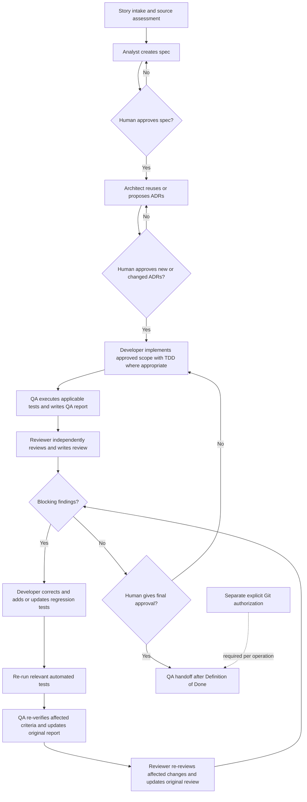

# Agentic Development Flow — Proposed Process (Not Yet Executed)

**Status: draft.** This document describes the planned process, not proof that any agent has executed it. Update the execution log below with genuine events and preserved records.

## Steps and planned outputs

| Step | What happens and why | AI used? | Agent / model / skill | Expected repository artifact | Human review, rejection path |
| --- | --- | --- | --- | --- | --- |
| 1. Ingest story | Read source and identify constraints | Yes | analyst; `gpt-6-luna` / `xhigh`; `story-to-spec` and `spec-driven-development` | `spec/US-XX.md` draft | Review omissions; send rejected specs back to analyst |
| 2. Approve spec | Make acceptance criteria verifiable | No | Human | `docs/approvals/` decision record | Do not proceed if rejected |
| 3. Choose architecture | Compare alternatives and consequences | Yes | architect; `gpt-6.2-sol` / `high`; `spec-driven-development`, `angular-developer`, plus relevant `modern-web-guidance` when needed | `docs/adr/ADR-XXX-*.md` | Reject weak/unsupported choices for revision |
| 4. Approve ADR | Resolve consequential trade-offs | No | Human | `docs/approvals/` decision record | Return to architect on rejection |
| 5. Implement story | Build a constrained increment | Yes | developer; `gpt-6.2-sol` / `medium`; `angular-developer`, `frontend-ui-engineering`, `test-driven-development`; conditional skills per `AGENTS.md` | `frontend/`, `backend/` and tests | Review scope and functional behavior |
| 6. Test | Verify story scope and applicable criteria | Yes | qa; `gpt-6-luna` / `xhigh`; `test-driven-development`; conditional skills per `AGENTS.md` | Tests and `reports/qa/US-XX-qa-report.md` | Record dependent flow-level checks as deferred until prerequisites exist |
| 7. Review | Independent defect/security analysis | Yes | reviewer; `gpt-6.2-sol` / `medium`; `code-review-and-quality`; conditional skills per `AGENTS.md` | `reviews/US-XX-review.md` | Findings return to developer; QA and Reviewer re-verify |
| 8. Final approval and QA handoff | Confirm Definition of Done, traceability, and evidence | No | Human | Approval record + traceability references | Do not advance without explicit approval |

## Actual execution log (fill only after real work)

| Date / event | User story | Actual agent / model / effort | Actual inputs and prompts | Outputs and commands | Human decision and review evidence | Original session reference |
| --- | --- | --- | --- | --- | --- | --- |
| Not started | — | — | — | — | — | — |

## Skill selection and controls

The project-specific `story-to-spec` skill defines the insurance assessment source and specification format. Other installed skills are third-party workflow or technical guidance. Select skills by stage and task as listed in `AGENTS.md`. Conditional skills are loaded only when the work warrants them. Project instructions and assessment requirements take precedence over conflicting skill guidance. Skills do not bypass security restrictions or human approval checkpoints. Record skills actually used in execution evidence and keep this proposed flow distinct from completed work.

## Git conventions and authorization

Use English Conventional Commit messages in `<type>(<optional-scope>): <description>` format, with focused atomic changes. Suggest a commit message when work is ready. Staging, committing, pushing, merging, branch creation or deletion, history rewriting, and destructive Git actions each require explicit human authorization for that operation. Approval of a specification or code does not grant Git authorization. Read-only Git inspection is allowed. Never place credentials, secrets, personal data, or sensitive information in commits or logs.

## Model allocation and usage

Keep the configured model and effort assignments from `docs/agent-model-policy.md`. Choose the least number of agents and skills needed for a task. Avoid loading all skills or invoking agents without a concrete independent responsibility. The project targets a ChatGPT Plus subscription, so use focused prompts, narrow source reads, sequential checkpoints, and only the context needed for each stage. Do not claim a subscription allowance, cost, or usage outcome that has not been verified.

## Required retrospective (complete with authentic experience)

## Traceability and verification levels

Maintain `User Story → spec/US-XX.md → applicable approved ADRs → implementation → stable test case IDs → reports/qa/US-XX-qa-report.md → reviews/US-XX-review.md → finding resolution evidence → human approval`. Reference repository paths and actual evidence. Reuse approved ADRs when they cover the story. Story reports cover the current story only. Complete quote-flow and cross-country verification are project-level checks before final delivery, not prerequisites for each story when later stories are pending.

### How would this flow change for a five-developer team?
To be completed after applying the process. Consider ownership boundaries, review queues, parallel safe tasks, and shared quality gates.

### What did not work as expected, and what changed?
To be completed using actual incidents only. Never invent a process failure.

### Where did we deliberately avoid using AI, and why?
To be completed using actual human checkpoints and decisions.
