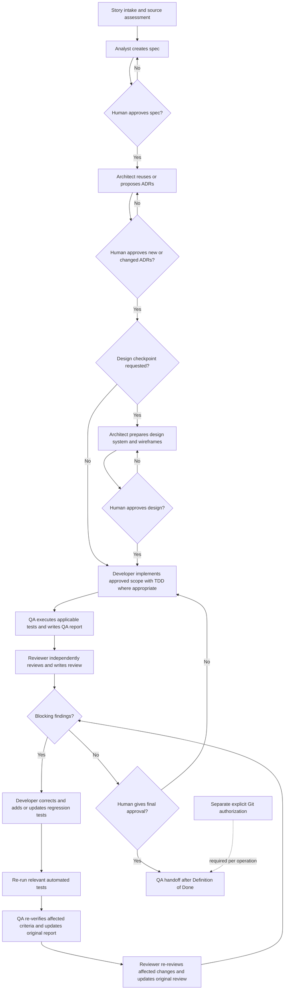

# Agentic Development Flow

See the execution log for completed stages and checkpoint status.

## Steps and planned outputs

| Step | What happens and why | AI used? | Agent / model / skill | Expected repository artifact | Human review, rejection path |
| --- | --- | --- | --- | --- | --- |
| 1. Ingest story | Read source and identify constraints | Yes | analyst; `gpt-6-luna` / `xhigh`; `story-to-spec` and `spec-driven-development` | `spec/US-XX.md` draft | Review omissions; send rejected specs back to analyst |
| 2. Approve spec | Make acceptance criteria verifiable | No | Human | `docs/approvals/` decision record | Do not proceed if rejected |
| 3. Choose architecture | Compare alternatives and consequences | Yes | architect; `gpt-6.2-sol` / `high`; `spec-driven-development`, `angular-developer`, plus relevant `modern-web-guidance` when needed | `docs/adr/ADR-XXX-*.md` | Reject weak/unsupported choices for revision |
| 4. Approve ADR | Resolve consequential trade-offs | No | Human | `docs/approvals/` decision record | Return to architect on rejection |
| 4a. Design the experience, when requested | Translate the approved specification and ADRs into reusable UI guidance and observable interactions | Yes | architect and applicable interface, accessibility, and web design skills | `docs/design/` proposal and wireframes | Return design feedback to architect |
| 4b. Approve design | Review layouts, components, states, and interactions before implementation | No | Human | `docs/approvals/` decision record | Wait for explicit design approval |
| 5. Implement story | Build a constrained increment | Yes | developer; `gpt-6.2-sol` / `low`; `angular-developer`, `frontend-ui-engineering`, `test-driven-development`; conditional skills per `AGENTS.md` | `frontend/`, `backend/` and tests | Review scope and functional behavior |
| 6. Test | Verify story scope and applicable criteria | Yes | qa; `gpt-6-luna` / `xhigh`; `test-driven-development`; conditional skills per `AGENTS.md` | Tests and `reports/qa/US-XX-qa-report.md` | Record dependent flow-level checks as deferred until prerequisites exist |
| 7. Review | Independent defect/security analysis | Yes | reviewer; `gpt-6-luna` / `high`; `code-review-and-quality`; conditional skills per `AGENTS.md` | `reviews/US-XX-review.md` | Findings return to developer; QA and Reviewer re-verify |
| 8. Final approval and QA handoff | Confirm Definition of Done, traceability, and evidence | No | Human | Approval record + traceability references | Do not advance without explicit approval |

## Actual execution log

| Date / event | User story | Actual agent / model / effort | Actual inputs and prompts | Outputs and commands | Human decision and review evidence | Original session reference |
| --- | --- | --- | --- | --- | --- | --- |
| 2026-11-21, 14:27 COT · Intake | US-01 | Orchestrator, `gpt-6.2-sol` / `medium` | User requested US-01 through the first human approval checkpoint. Read `AGENTS.md` and `requirements/technical-assessment.pdf`. Skills used were `using-agent-skills` and `pdf`. | Extracted the assessment with bundled Python and `pypdf.PdfReader`. Rendered and visually checked pages 5–6 with `pypdfium2.PdfDocument`. | Confirmed story title, business rules, and four source acceptance scenarios. | Codex Desktop original `01a1ff94-4d15-7ad2-9b6b-fdabfc1dc367`, started 2026-11-21 14:27:51 COT. |
| 2026-11-21, 14:28 COT · Specification draft | US-01 | `analyst` at `/root/us01_analyst`, `gpt-6-luna` / `xhigh` | Asked the analyst to draft only `spec/US-01.md` from the original source and project instructions, with country cases, stable acceptance and test IDs, validation boundaries, state handling, and open questions. The analyst used the repository's `story-to-spec` and `spec-driven-development` skills. | The analyst extracted the PDF using bundled Python and drafted the specification. The orchestrator compared the draft with the assessment and requested corrections to source references and coverage. | The draft was pending human approval. | Codex Desktop original `01a1ff94-bc29-7403-8d97-7240a466b406`, started 2026-11-21 14:28:20 COT. |
| 2026-11-21, 14:30 COT · Specification revision | US-01 | Same analyst session, `gpt-6-luna` / `xhigh` | Asked the analyst to correct the typed-forms page reference, distinguish project state requirements from the assessment, and add an explicit source-to-test crosswalk and verification for accessibility, responsive layouts, field configuration, and removing or reordering published fields. | The analyst revised `spec/US-01.md`. The orchestrator ran a Python crosswalk check and verified that all 14 source items, 10 acceptance criteria, and 10 proposed tests are represented. | Source review and document checks only. Application tests are proposed for later stages. | Same analyst original, revision turn started 2026-11-21 14:30:21 COT. |
| 2026-11-21 · Specification approval checkpoint | US-01 | Orchestrator, `gpt-6.2-sol` / `medium` | Presented `spec/US-01.md` Draft 1 for explicit human approval or rejection. | Specification and execution log available for review. | Awaited the project owner's decision on Draft 1. | Same orchestrator original. |
| 2026-11-21, 15:03 COT · Specification feedback | US-01 | Project owner, then orchestrator `gpt-6.2-sol` / `medium` | The owner answered Q-US01-01, Q-US01-02, Q-US01-04 through Q-US01-07, and Q-US01-09. | The orchestrator asked the analyst to apply the answers to the draft and related acceptance criteria and tests, and to retain unanswered details. | The owner supplied decisions on individual questions. The specification approval checkpoint remains open. | Same orchestrator original, feedback turn started at 15:03:40 COT. |
| 2026-11-21 · Revised specification | US-01 | Same analyst session, `gpt-6-luna` / `xhigh`, then orchestrator | Incorporated the owner's answers on age, locale year, URL country context, stable field identifiers, cache freshness, progressive validation, and Spanish copy. | The analyst updated `spec/US-01.md` to Draft 2. The orchestrator cross-checked the seven answers, five remaining question entries, 14 source items, 12 acceptance criteria, and 12 proposed tests. | Draft 2 is pending explicit human approval. | Same analyst original, feedback revision started at 15:03:50 COT. |
| 2026-11-21, 15:14 COT · Outstanding specification decisions | US-01 | Project owner, then orchestrator `gpt-6.2-sol` / `medium` | The owner supplied written decisions for Q-US01-03, Q-US01-04, Q-US01-05, Q-US01-07, and Q-US01-08. | The orchestrator delegated incorporation of the validation contract, country URL rules, reconciliation, progressive validation, and configuration failures to the analyst. | The owner requested a revised draft and a stop at the specification approval checkpoint. | Same orchestrator original, feedback turn started at 15:14:41 COT. |
| 2026-11-21 · Specification Draft 3 | US-01 | Same analyst session, `gpt-6-luna` / `xhigh`, then orchestrator | The analyst incorporated the owner's refinements as human clarifications, traced them to acceptance criteria and proposed tests, and separated resolved requirements from deferred architecture details. | Updated `spec/US-01.md` to Draft 3. The orchestrator used a Python document check to verify nine resolved question IDs, 11 validation operators, 14 source items, 16 acceptance criteria, and 16 proposed tests. `git diff --check` passed. | Draft 3 is pending explicit human approval. | Same analyst original, feedback revision started at 15:14:54 COT. |
| 2026-11-21, 15:25 COT · Specification approved | US-01 | Project owner, then orchestrator | The owner wrote “approve Draft 3”. | Recorded the decision in `docs/approvals/US-01-spec-approval.md` and updated the approval metadata in `spec/US-01.md`. | Draft 3 approved. Workflow stopped at the specification checkpoint as requested. | Same orchestrator original. |
| 2026-11-21, 15:33 COT · Architecture intake | US-01 | Orchestrator, `gpt-6.2-sol` / `medium`, then `architect` at `/root/us01_architect`, `gpt-6.2-sol` / `high` | The owner requested a technology-stack proposal, a country strategy, and consideration of shared needs for US-02 and US-03. The approved US-01 spec, approval record, and original assessment were supplied to the architect. | The orchestrator independently checked official Angular, Strapi, Tailwind CSS, and Tabler documentation and the assessment's cross-story requirements. | The owner's stack preferences and new architectural decisions are proposals. | Codex Desktop architect original `01a1ffd0-8d90-70c2-91c2-cb922bbb8cdd`, started 2026-11-21 at 15:33:40 COT. |
| 2026-11-21 · Architecture proposals and approval checkpoint | US-01 | Same architect session, `gpt-6.2-sol` / `high`, then orchestrator | The architect used the repository's `spec-driven-development` and `angular-developer` skills and the bundled `modern-web-guidance` guides on validation after interaction, required-field feedback, and accessible error announcements. The architect extracted assessment pages 1–3 and 6–9 and consulted official stack documentation. | Produced `docs/architecture/US-01-technology-stack.md` and ADR-001, ADR-002, and ADR-003 under `docs/adr/`. Python document checks verified four pending proposals, valid relative links, stack coverage, and all 11 validation operators. `git diff --check` passed. Package installation, builds, and runtime verification remain future work. | Presented the architecture proposals for explicit human approval. No architecture approval or implementation was undertaken. | Same architect original, turn `01a1ffd0-8e18-7730-bc13-629ba331494e`, and orchestrator original. |
| 2026-11-22 · Architecture approved | US-01 | Project owner, then orchestrator | The owner wrote “approve the stack proposal and ADR-001 through ADR-003”. | Recorded the decision in `docs/approvals/US-01-architecture-approval.md` and updated the status in all four approved artifacts. | Architecture checkpoint complete. Workflow stopped before implementation as requested. | Same orchestrator original. |
| 2026-11-22, 08:58 COT · Design intake | US-01 | Orchestrator, `gpt-6.2-sol` / `medium`, then architect, `gpt-6.2-sol` / `high` | The owner requested a reusable design system and desktop and mobile wizard wireframes. The orchestrator delegated the design to the architect using the approved US-01 specification, ADR-001 through ADR-003, the approved stack, and the assessment's later-story scenarios. | Added the requested design checkpoint to this workflow and checked W3C WCAG 2.2 and form notification guidance. | Design review is a dedicated human checkpoint. | Same architect original, design turn `01a2038d-164b-7d33-87ea-ef249e83f879`, started at 08:58:29 COT. |
| 2026-11-22 · Design proposal and approval checkpoint | US-01 | Same architect session, `gpt-6.2-sol` / `high`, then orchestrator | The architect used `interface-design`, `frontend-ui-engineering`, `accessibility`, and the bundled `modern-web-guidance` guides on interaction validation, required fields, and accessible error announcements. The design follows the approved US-01 artifacts and uses assessment pages 6–9 for story context. | Produced `docs/design/US-01-design-system.md`, `docs/design/US-01-wireframes.md`, and 26 SVG wireframes. The architect checked all 16 acceptance criteria references, local links, accessible names, and token contrast. The orchestrator independently rendered all 26 SVGs with bundled Sharp and visually reviewed desktop and mobile contact sheets. | Presented for explicit human design approval. US-02 and US-03 are design concepts, with production behavior reserved for their own checkpoints. | Same architect design turn and orchestrator turn `01a2038c-c310-7671-960a-a2b85f8b8990`. |
| 2026-11-22, 09:25 COT · Design feedback | US-01 | Project owner, then orchestrator and architect | The owner requested a centered desktop step, primary color `#2E6DF6`, and removal of the country name and change text from the header. | The orchestrator delegated the revision and checked the primary fill against white text. | The design remains pending explicit approval. | Same architect original, revision turn `01a203a5-b6db-7c00-b7c1-0877f2516bde`, started at 09:25:21 COT. |
| 2026-11-22 · Revised design proposal | US-01 | Same architect session, `gpt-6.2-sol` / `high`, then orchestrator | Applied the owner's three design changes. Kept country switching available below progress in the main content and used a darker blue for inline links and focus. | Updated both design documents and all 26 SVGs. Rendered the wireframes with bundled Sharp and used a Python XML check to verify 26 product-only headers, 22 in-content country controls, and 11 centered desktop step compositions. White on the primary blue measured 4.53:1. | Revised design presented for explicit human approval. | Same architect revision turn and orchestrator turn `01a203a5-71f1-7830-992a-69fa822cc302`. |
| 2026-11-22, 09:33 COT · Country control removal | US-01 | Project owner, then architect, `gpt-6.2-sol` / `high`, and orchestrator | The owner supplied a screenshot of the country badge and change-country link and requested removal wherever they appeared in wizard steps. | Updated both design documents and removed the control from 22 desktop and mobile SVGs. Rendered all 26 wireframes with bundled Sharp. A Python XML and hash check verified removal and preservation of the four country picker and unsupported-country recovery frames. | Revised proposal remains pending explicit human design approval. | Same architect original, revision turn `01a203ad-0e5b-7631-b741-68ba7e746c72`, started at 09:33:22 COT. |
| 2026-11-22 · Design approved | US-01 | Project owner, then orchestrator | The owner wrote “approve the design”. | Recorded `docs/approvals/US-01-design-approval.md` and updated the status in both design documents. Verified the approved wireframe set by hash. | Design checkpoint complete. Workflow stopped before implementation as requested. | Same orchestrator original. |
| 2026-11-22, 09:39 COT · Implementation intake | US-01 | Orchestrator and `developer` at `/root/us01_developer`, both `gpt-6.2-sol` / `medium` | The owner requested implementation through QA, independent review, and final human approval. The orchestrator delegated US-01 against the approved spec, architecture, stack, and design, with TDD and release evidence. | Read-only Git inspection verified a clean starting tree. Node 24 is installed and bare pnpm is version 12, so the implementation must use the approved pnpm 11 pin. OrbStack was started under a scoped approval after its local socket was unavailable. | Implementation authorized. Git mutations remain unauthorized. New dependencies outside the approved stack and changes to approved decisions remain separate checkpoints. | Codex Desktop developer original `01a203b2-e546-7670-ab7f-9562b27dcfa4`, started at 09:39:45 COT. |
| 2026-11-22 · Implementation and developer verification | US-01 | Same developer session, `gpt-6.2-sol` / `medium`, and orchestrator | Implemented the Angular wizard, shared typed form contract, Strapi content and seeds, and Compose startup. Skills used were `angular-new-app`, `angular-developer`, `frontend-ui-engineering`, `test-driven-development`, `modern-web-guidance`, `security-and-hardening`, and browser-testing guidance with Playwright. | TDD started with the missing shared contract and frontend route tests failing. The developer reported `pnpm test` passing five contract and two Angular tests, `pnpm test:content` passing one isolated live content integration, `pnpm lint`, `pnpm format:check`, and `pnpm build` passing, and three Chromium Playwright tests passing against the running stack. | Initial container checks uncovered a missing Angular signal invocation and required Strapi favicon middleware. The developer corrected both. The orchestrator verified a successful Compose build and startup from a fresh isolated volume, and HTTP 200 country deep links and form reads for CO and CL. Independent QA follows. | Developer turn `01a203b2-e595-71d2-b6cd-287bea3d226d` and orchestrator turn `01a203b2-a09e-7011-a674-2dbd729c38a2`. |
| 2026-11-22, 10:00 COT · Independent QA interrupted | US-01 | `qa` at `/root/us01_qa`, `gpt-6-luna` / `xhigh` | Asked QA to independently verify the approved acceptance criteria against the rebuilt Compose stack and record results, omissions, and defects. | QA reported five shared and two Angular tests passing, one live Strapi publication test passing on a disposable database, and three browser tests passing with installed Google Chrome. Additional keyboard coverage in `e2e/us01-qa.spec.ts` was still in progress. | QA hit its model usage limit before producing its required report. No product blocker had been confirmed. The orchestrator requested approval before substituting a model. Independent review remains pending. | Codex Desktop QA original `01a203c5-dd72-73c0-9ed7-7945930842d2`, started at 10:00:28 COT. |
| 2026-11-22 · Strapi first-run verification | US-01 | Orchestrator, `gpt-6.2-sol` / `medium` | The owner asked whether the first-run screen requires local or Cloud registration. The orchestrator used browser-testing guidance and isolated Playwright Chrome, and checked official Strapi documentation. | Read-only GET checks and browser navigation found `hasAdmin: false`, local `/admin/auth/register-admin`, public app admin routes HTTP 404, and both published form endpoints HTTP 200 with 8 CO and 7 CL fields. Clarified the optional editorial account in `README.md`. | Public evaluation needs no administrator account. Account creation and authenticated editorial verification were outside this request. | Orchestrator original. |
| 2026-11-22, 10:18 COT · Frontend structure assessment | US-01 | Architect, `gpt-6.2-sol` / `high`, then orchestrator | The owner asked to assess feature-based organization, test colocation and naming, root Playwright coverage, and reuse of the shared package. The architect used the Angular developer skill and official style guide. | Wrote `docs/architecture/US-01-frontend-structure-assessment.md` with the current-to-proposed mapping, alternatives, migration risks and verification steps. Checked local links and repository whitespace. | Structural refactor awaits separate explicit approval and is outside current verification. | Same architect original, assessment turn `01a203d6-97f2-7d90-8104-73a2f09d2984`. |
| 2026-11-22, 10:36 COT · Independent QA resumed | US-01 | Same QA session, `gpt-6-luna` / `xhigh` | The owner requested a retry using the configured QA model and the existing test evidence. | The original QA subagent resumed its unfinished verification and report. The native session record confirmed the configured model and effort. | No replacement model was required. | Same QA original, resumed turn `01a203e6-62c3-7f72-9fd4-162b1a6a1006`. |
| 2026-11-22 · Independent QA report | US-01 | Same QA session, `gpt-6-luna` / `xhigh` | QA used `test-driven-development`, Angular testing guidance, `browser-testing-with-devtools` with Playwright and `debugging-and-error-recovery`. | Added focused shared and browser verification. The report records nine shared and two Angular tests, one live Strapi content test, six Chrome Playwright cases, lint, formatting, and a successful cache-disabled Angular build. | QA found no confirmed product defect and recommended independent review. A full keyboard-only completion and a combined real publication and browser reload still lacked end-to-end evidence. | Same QA original and resumed turn. |
| 2026-11-22 · Independent code review and correction checkpoint | US-01 | `reviewer` at `/root/us01_reviewer`, `gpt-6.2-sol` / `medium` | Reviewed the approved artifacts, implementation and QA evidence using `code-review-and-quality`. | Wrote `reviews/US-01-review.md` with five Medium blocking findings, US01-R01 through US01-R05. Browser and Node probes reproduced the first four. The fifth was established by inspection of app bootstrap and the pinned Strapi permissions plugin. | Changes requested. The orchestrator requested explicit permission to adjust the Strapi Public role for US01-R05. No Strapi settings or administrator accounts changed. | Codex Desktop reviewer original `01a203f5-ba5a-7653-a44c-532946bacda7`, review turn `01a203f5-bacb-7380-b491-ce0f40bc01a8`. |
| 2026-11-22 · Targeted keyboard QA follow-up | US-01 | Same QA session, `gpt-6-luna` / `xhigh` | Asked QA to close the keyboard and publication evidence gaps without repeating completed checks unless affected. | Verified a complete valid Colombia form and return path with Chrome key events only. All six browser cases passed after updating the keyboard test. Updated the original QA report. | The full keyboard smoke passed with seeded content. The review findings still require targeted follow-up checks. The combined real Strapi publication and browser reload check was parked at the correction checkpoint. | Same QA original, follow-up turn `01a203f5-fec9-7202-b429-dbaa2d6381c4`. |

### US-01 correction and refactor

After initial commit `cb705ed`, the owner authorized US01-R01 through US01-R05 and the feature-folder proposal. See [the authorization record](docs/approvals/US-01-correction-and-refactor-approval.md). The original developer resumed with the repository's current `gpt-6.2-sol` / `low` assignment in turn `01a20409-49e1-78f2-91e9-9da61d2bdf81`. Targeted RED checks reproduced all five findings. The developer verified the corrections before moving the frontend source and its routed TestBed suite. Post-move results were 13 unit/component tests, one Strapi integration test, lint, formatting, builds, and eight browser tests discovered. The orchestrator rebuilt Compose before and after the moves and both services became healthy. QA owns the final browser run and live-publication evidence.

Independent QA resumed on `gpt-6-luna` / `xhigh` in turn `01a2040d-b2a0-7960-9f61-db3491d3dd9f`. [The QA report](reports/qa/US-01-qa-report.md) records 13 unit/component tests, eight Playwright cases, one Strapi content integration test, and a live disposable Strapi-to-browser check. Publishing, unpublishing, and retry behaved as expected with the same Angular bundle and retained browser draft.

The historical reviewer session resumed on its former `gpt-6.2-sol` / `medium` model and was interrupted. The current configured reviewer completed re-review on `gpt-6-luna` / `high` in original session `01a20418-f037-7262-9db7-01191d79882d`, turn `01a20418-f092-70f3-a48b-eaaed0e2a006`. [The review report](reviews/US-01-review.md) preserves all original findings and marks US01-R01 through US01-R05 resolved. US-01 is ready for the final human approval checkpoint.

### US-01 final approval and QA handoff

The project owner explicitly approved US-01. The [final approval record](docs/approvals/US-01-final-approval.md) links the approved artifacts, corrections, QA report, independent re-review, and deferred project verification. The developer and independent agents completed the story-level checks, all five findings are resolved, and the story is ready for QA handoff. The separate authorized fixes and refactor commits are `9b1c24d` and `068dbc1`.

### US-01 session evidence

The current local evidence inventory is indexed in [`logs/README.md`](logs/README.md). It identifies the US-01 main conversation and delegated Analyst, Architect, Developer, QA, and Reviewer threads, including the later styling follow-up. The raw exports contain account identifiers in session metadata and have not been cleared for submission; see the evidence reconciliation below. Historical notes about missing repository exports describe the state at the time they were written.

### 2026-11-22 · Approved Tailwind styling audit and correction

The project owner requested an audit against the approved US-01 architecture and authorized correcting the styling deviation, with build, lint, UI regression checks, and independent verification. The approved technology stack already selected Tailwind CSS 4 and its Angular-supported PostCSS path; no architecture or design decision changed.

- **Audit finding:** `frontend/package.json` pins `tailwindcss` and `@tailwindcss/postcss` to 4.3.5; `frontend/.postcssrc.json` registers the plugin; `frontend/src/styles.css` imports Tailwind and declares approved theme tokens; `frontend/angular.json` loads that stylesheet. Tailwind was installed, configured, and active, but templates mainly used semantic class names while global CSS applied utilities with `@apply`. This did not use template utilities as the primary styling surface required by the approved stack.
- **Correction:** Moved layout, spacing, responsive grid, typography, palette, controls, and component appearance into statically discoverable Angular template utilities. Retained CSS for theme/base rules, constrained content widths, focus and text wrapping behavior, dynamic invalid controls, selected placeholder color, the progress connector pseudo-element, and reduced motion. Added no dependency and preserved the pre-existing owner edit that removed the country-picker footer copy.
- **Initial regression discoveries:** The first utility migration removed semantic selector hooks used by the existing UI regression assertions; those hooks were restored without restoring CSS-driven component styling. Independent review then found a 40rem `sm` form breakpoint where the approved design requires 48rem. Changed the grid and action variants to Tailwind `md` (48rem), preserving the finding history in the original review report.
- **Orchestrator verification:** `pnpm lint` passed; `CI=1 pnpm build` passed (the plain initial host build had the known local Angular cache abort, exit 134); `CI=1 pnpm --filter quote-web build` passed against the final frontend state; `pnpm format:check` and `git diff --check` passed. Docker Compose rebuilt and reported healthy app and CMS services. The final `QUOTE_BROWSER_CHANNEL=chrome pnpm exec playwright test --workers=1` passed 8/8 Chromium cases. The first sandboxed browser attempts could not launch Chrome; execution outside the sandbox was approved for local UI verification.
- **Independent QA:** Delegated to `/root/styling_qa` under the configured QA role, `gpt-6-luna` / `xhigh`. QA independently reported lint, cache-disabled frontend build, format check, Compose startup, and 8/8 Playwright pass; a Chrome viewport probe at 640, 767, 768, and 800px confirmed one-column form and full-width Continue below 768px, two columns and 160px Continue at and above 768px, and the expected 58px progress track at all widths. QA appended the detailed evidence to [`reports/qa/US-01-qa-report.md`](reports/qa/US-01-qa-report.md).
- **Independent review:** Delegated to `/root/styling_review` under the configured reviewer role, `gpt-6.2-sol` / `medium`, using `code-review-and-quality`. The reviewer confirmed Tailwind setup and primary utility use, documented `US01-TW-R01` for the breakpoint mismatch, and preserved its original evidence in [`reviews/US-01-review.md`](reviews/US-01-review.md). After the orchestrator corrected the variants and QA verified boundary behavior, the reviewer re-reviewed the correction, marked US01-TW-R01 resolved, and approved this scoped styling change.
- **Session reference:** The collaboration tool did not expose native Codex Desktop session IDs for these two delegated invocations at the time; none was invented. A later local export inventory identified the styling QA and Reviewer records. See [`logs/README.md`](logs/README.md). The raw files remain unapproved for submission pending privacy review.

### 2026-11-22 · US-02 intake and specification

- The project owner requested US-02 through the specification approval checkpoint. The orchestrator read `AGENTS.md` and `FLOW.md`, used the PDF skill to extract the relevant assessment text with bundled `pypdf.PdfReader`, and checked the existing Plans route and approved architecture and design references.
- The orchestrator delegated [US-02 Draft 1](spec/US-02.md) to `/root/us02_analyst`, using the configured Analyst role (`gpt-6-luna` / `xhigh`). The prompt scoped the work to the source requirements, testable acceptance criteria, US-01 reuse, and genuine gaps. The Analyst used `story-to-spec` and `spec-driven-development`, extracted assessment pages 2–3 and 7 with bundled `pypdf`, and reviewed the relevant US-01 artifacts, routes, state and shared contracts. The collaboration path identifies the original invocation. A native session ID and a safe, unedited repository export were unavailable in this run. The original activity remains in Codex.
- The orchestrator requested tighter criteria for the same-country handoff, explicit selection, stale prices, and Back navigation. The same Analyst revised Draft 1, checked whitespace with `git diff --check -- spec/US-02.md`, and returned the updated draft. The orchestrator checked the draft against the source and used Python to verify 11 source IDs, seven acceptance criteria, seven proposed test IDs, and pending approval status.
- Draft 1 is pending human approval. The proposed pricing baseline uses the configured base price as the final price. The plan content contract, public read projection and selection/price snapshot are scoped for architecture review after specification approval. Application verification was outside this checkpoint.

- The project owner wrote “approve Draft 1 as written”. The orchestrator recorded the [specification approval](docs/approvals/US-02-spec-approval.md), including the approved draft hash and the base-price proposal, and updated the specification's approval metadata. The workflow stopped at the completed specification checkpoint as requested.

### 2026-11-22 · US-02 architecture proposal

- The project owner requested architecture assessment through human approval. The orchestrator verified the approved US-02 specification and its pricing decision, then asked `/root/us02_architect`, using the configured Architect role (`gpt-6.2-sol` / `high`), to reuse ADR-001 through ADR-003 and document only gaps in the plan read contract and quote-state handoff.
- The Architect used `spec-driven-development` and `angular-developer`, including HTTP and route guard references. The Architect extracted relevant assessment pages with bundled `pypdf`, checked the existing routes, public permissions, proxy and quote state, and consulted official Strapi, Angular and ECMAScript internationalization documentation. The Architect produced one proposed [ADR-004](docs/adr/ADR-004-plan-catalog-and-selection.md), with the plan read contract, money representation and selection revalidation. The collaboration path identifies the invocation. The original activity remains in Codex. A native session ID and a safe repository export were unavailable in this run.
- The Architect checked relative links, pricing, status, whitespace and ADR count. The orchestrator used Python to verify local links, pending approval status, alignment with the approved base-price decision, and controls for the public read and handoff. Runtime verification is deferred to implementation. The proposal is pending explicit human approval at the architecture checkpoint.

- The project owner wrote “approve ADR-004”. The orchestrator recorded the [architecture approval](docs/approvals/US-02-architecture-approval.md) and updated ADR-004's approval metadata. The workflow stopped at the completed architecture checkpoint as requested.

### 2026-11-22 · US-02 design proposal

- After architecture approval, the owner wrote “continue”. The orchestrator treated this as authorization for the design proposal through the next human checkpoint and resumed `/root/us02_architect` (`gpt-6.2-sol` / `high`). The prompt requested reuse of the approved design system and Plans concepts, with any additions limited to US-02 states and interactions.
- The Architect used `interface-design`, `frontend-ui-engineering`, `accessibility`, and `modern-web-guidance`. The Architect produced [the US-02 plan selection proposal](docs/design/US-02-plan-selection.md) and one desktop comparison SVG. The Architect rendered four frames with Sharp, checked source links, acceptance-criteria coverage, SVG names and state indicators with Python, measured five contrast pairs, and verified money examples with Node `Intl`. The orchestrator read the proposal against the approved scope and visually inspected the rendered desktop comparison. Application and assistive-technology verification remain pending implementation.
- The original activity remains in Codex under the same Architect collaboration path. Design approval is pending an explicit human decision.

- The project owner wrote “approve the US-02 design”. The orchestrator recorded the [design approval](docs/approvals/US-02-design-approval.md), captured the design and wireframe hashes, and updated the design's approval metadata. The design checkpoint is complete.

### 2026-11-22 · US-02 implementation intake

- The owner authorized implementation through independent QA, review and the final human approval checkpoint. The orchestrator verified a clean starting tree and the specification, architecture and design approval records. The orchestrator assigned implementation and developer tests to `/root/us02_dev` using the configured Developer role (`gpt-6.2-sol` / `low`). The prompt required TDD, reuse of US-01 code and infrastructure, and the approved Strapi base-price rule. Git mutations and US-03 work remain outside this authorization.

- The Developer used `modern-web-guidance`, `angular-developer`, `frontend-ui-engineering` and `test-driven-development`. RED checks exposed the absent shared catalog decoder, missing Angular Plans request and Strapi 404. The increment added the shared catalog contract, Strapi plan projection and startup content, narrow public proxy path, and Angular plans and summary handoff. The Strapi base price is the final price.
- Developer GREEN checks passed with `CI=1 pnpm test` (13 shared and four Angular tests), `pnpm test:content` (one disposable live Strapi test), `CI=1 pnpm build`, CMS typecheck, lint, format and whitespace checks. The host Strapi build emitted a preferences permission warning and completed. Eight existing US-01 browser regressions passed in the freshly seeded isolated `us02-verify` Compose project at port 18080. Two earlier failures on the existing local volume were attributable to its edited CO form fixture. That data was preserved.
- The orchestrator delegated independent QA to `/root/us02_qa` using the configured QA role (`gpt-6-luna` / `xhigh`). The prompt requested coverage across both countries, publication and public permissions, real-browser behavior, invalidation and recovery, and evidence in the story QA report. The Developer's original activity remains in Codex under the collaboration path.

- Independent QA used `test-driven-development` and `angular-developer`. QA added six US-02 Playwright cases and recorded all seven acceptance-criteria outcomes in [the QA report](reports/qa/US-02-qa-report.md). QA passed 13 shared tests, four Angular tests, the live Strapi publication and permission integration, and all 14 Chrome cases. Lint, format and CI build passed. QA found no blocking defects, recorded coverage limits, and recommended independent review.
- The orchestrator delegated independent review to `/root/us02_review` using the configured Reviewer role (`gpt-6-luna` / `high`). The prompt requested a diff-based review against the approved specification, ADR, design and QA evidence, with reproducible findings in the story review. The original QA activity remains in Codex under the collaboration path.

- The Reviewer used `code-review-and-quality`, independently passed `CI=1 pnpm test` (13 shared and four Angular tests), reviewed the live QA evidence, and recorded no findings in [the US-02 review](reviews/US-02-review.md). No production corrections were required.
- The same QA agent verified 320 CSS px reflow, equivalent to the layout width at 400% zoom from 1280 CSS px, and added a Chrome forced-colors check. The final browser run passed 15/15. The same Reviewer inspected the forced-colors evidence and updated the original report. No source changes were needed. Native screen-reader and native operating-system high-contrast sessions remain unverified.
- The active Codex conversation preserves the original delegated activity. Native session identifiers and a safe unedited repository export were unavailable. The orchestrator presented US-02 for final human approval. The full Summary and payment flow remains deferred to US-03 and project-level verification.

### 2026-11-22 · US-02 seed catalog revision

- Before final approval, the owner requested another plan for Colombia and Chile and expanded benefits across all plans. The orchestrator resumed `/root/us02_dev` (`gpt-6.2-sol` / `low`) to update the fictitious Strapi seed and relevant tests while preserving the original publication and bootstrap policy. The approved specification, ADR and design remain applicable.
- The Developer added Integral for both countries and expanded the Spanish benefit lists for Esencial, Ruta and Integral to three, four and five items. The new live seed assertions first failed because only two plans were present. The Developer then passed `pnpm test:content` on fresh disposable SQLite, CMS typecheck, targeted Prettier and `git diff --check`. The existing seed marker preserves initialized data and editor changes.
- The orchestrator resumed `/root/us02_qa` (`gpt-6-luna` / `xhigh`) for independent verification of the revised catalog in both countries, using isolated data.
- QA verified both live catalogs on the fresh `us02-seed-qa` Compose project, including order, benefit counts and local currency. The updated browser suite passed 15/15 and the Strapi publication integration passed 1/1. The orchestrator resumed `/root/us02_review` (`gpt-6-luna` / `high`) for a scoped review of the seed revision and test evidence. The Reviewer recorded no findings. Both agents updated the original story reports. The revised story awaits final human approval.

### 2026-11-22 · US-02 development catalog synchronization intake

- The owner requested a fresh-install and existing-development catalog reconciliation while preserving content, accounts and isolated QA. The orchestrator resumed `/root/us02_architect` (`gpt-6.2-sol` / `high`) for a read-only assessment. The Architect found that a maintenance command using the existing Strapi Document Service and preserving normal startup fits ADR-004. The Architect recommended comparing both draft and published values with the original and revised fixtures, blocking conflicts before changes, and recording provenance for Integral.
- The orchestrator resumed `/root/us02_dev` (`gpt-6.2-sol` / `low`) to implement and test the explicit dry-run/apply workflow on disposable databases. The orchestrator identified the main `multi-country-car-insurance` Compose project and its existing `strapi-content` volume as the requested target. Both QA projects run independently on other ports and volumes.

- The Developer implemented the maintenance workflow with TDD and verified the CLI on a disposable Docker volume. `pnpm test:content` passed 2/2. CMS typecheck, targeted format, shell and Node syntax, and whitespace checks passed. The disposable dry run left the source database unchanged; apply updated four benefits lists and created two plans, and a second preview reported no changes.
- The orchestrator ran the main development dry run against the read-only volume. It blocked on `co/Ruta`, and the whole-revision guard also withheld both Integral inserts. The orchestrator inspected only the relevant fields with a read-only SQLite query and confirmed that the draft and published price were both COP 179,900.00, compared with COP 159,900.00 in the fixture. Development data remained untouched. The owner wrote “confirm 179.900.00” in response to the request to preserve or restore the price. The orchestrator resumed the Developer for an explicit price-preserving reconciliation with the existing guards.

- The Developer added an explicit `--preserve-co-ruta-price` option, bound it to the preview fingerprint, and verified that only the approved exact price bypasses the price mismatch. Other draft or published differences still block. Revised content integration passed 2/2 and the isolated CLI demonstrated default conflict, approved preview/apply and repeat no-op. The Developer removed only its disposable CLI smoke-test fixture volumes. Existing development and QA volumes remained intact.
- Independent QA resumed under `/root/us02_qa`, passed the content integration 2/2, verified six keeps and no conflicts on a fresh isolated read-only preview, and passed 15/15 Chrome cases. QA documented the results in the original report. The orchestrator rebuilt only the development CMS image and previewed the approved price-preserving apply. The preview reported four benefits updates, two Integral creates and zero conflicts. The orchestrator resumed `/root/us02_review` for independent review before applying to development.

- The Reviewer recorded no findings for the maintenance implementation. The orchestrator stopped only the main development Compose services, applied the reviewed fingerprint with `--preserve-co-ruta-price 179900.00`, and restarted development using `up -d --no-build --wait`. Apply backed up the development database and reported `applied`, four benefits updates, two creates and zero conflicts. A second read-only preview reported `noop` with six keeps and zero conflicts. The administrator count and identity checksum matched before and after. The development Angular image ID was unchanged. QA instances and their existing volumes were left separate.

- Independent QA navigated the main development Angular app through both Details forms and verified the published catalog in Chrome. Both countries displayed three plans with 3, 4 and 5 benefits. Colombia Ruta displayed COP 179.900,00, and Chile Ruta displayed CLP 29.900. The focused Playwright probe passed 1/1. The orchestrator also verified development through ports 1337 and 8080 and confirmed that the isolated QA server retained its independent seed price before cleanup.
- The owner confirmed the catalog display and authorized removing unused Docker containers and images. The orchestrator removed ten temporary verification containers and eleven unused project images, retained the two main development containers and their images, and verified that all six volumes present before cleanup remained available. Unrelated Docker images were left alone.

### 2026-11-22 · US-02 plan card design revision

- The owner requested three cards in one row when space allows and selection by clicking the card. The orchestrator confirmed that the approved design and current template cap the layout at two columns. The orchestrator resumed `/root/us02_architect` (`gpt-6.2-sol` / `high`) to propose a narrow revision without changing the approved story or ADR.
- The Architect used `interface-design`, `frontend-ui-engineering`, `accessibility` and `modern-web-guidance`, documented the responsive grid and native radio label interaction, and checked width thresholds, links and the original wireframe hash. The [design revision](docs/design/US-02-card-layout-revision.md) awaits explicit human approval under step 4b.

- The owner explicitly approved the design revision and authorized implementation through final human approval. The orchestrator recorded the [design revision approval](docs/approvals/US-02-card-layout-design-approval.md) and the approved revision hash.

- The orchestrator resumed `/root/us02_dev` (`gpt-6.2-sol` / `low`) for the approved revision. The Developer used `test-driven-development`, `angular-developer`, `frontend-ui-engineering` and `modern-web-guidance`. The initial Playwright run against the prior app showed the grid stayed at one column at 536 CSS px of lane width and a price click did not select the radio. The template change and two Playwright cases passed against the updated Angular app. The cases covered width thresholds, long copy, title, price, coverage, benefit and padding hits, touch, direct radio interaction, keyboard and forced-colors focus. Build, 13 shared tests, four Angular tests, lint, format and whitespace checks passed.
- The orchestrator rebuilt only the main Angular web container and confirmed it reached healthy status. The existing CMS and development data remained in use. The orchestrator resumed `/root/us02_qa` (`gpt-6-luna` / `xhigh`) for independent browser verification, with no additional Docker stack.

- Independent QA passed the two focused card tests and a separate live Chrome probe on the main development app. At lane widths 280/535/536/815/816/928 CSS px, the grid used 1/1/2/2/3/3 columns without horizontal overflow. Both country catalogs displayed three cards on one wide row. QA verified pointer and touch selection, native radio keyboard operation, stable card positions and visible focus with forced colors. The original [QA report](reports/qa/US-02-qa-report.md) contains the commands and results.
- The orchestrator resumed `/root/us02_review` (`gpt-6-luna` / `high`) after QA. The Reviewer inspected the template and focused tests and reported no findings in the original [review](reviews/US-02-review.md). No production corrections were required. US-02 is presented again for final human approval. The original delegated evidence is retained in Codex under the collaboration paths.

### 2026-11-22 · US-02 final approval and QA handoff

- The project owner wrote “approve US-02”. The orchestrator recorded the [final approval](docs/approvals/US-02-final-approval.md), including the catalog maintenance and card design revisions, and closed the story checkpoint. The increment is ready for QA handoff. Git operations and US-03 remain separate.

### 2026-11-22 · US-02 commit split

- The owner authorized four local commits for the approved US-02 work. The orchestrator used `git-workflow-and-versioning`, inspected the diffs and staged only the authorized paths. Core implementation and tests landed in `0f1cfed`, including the fresh-install plan fixtures required by catalog tests. Existing-database synchronization, seed tracking and maintenance tests landed in `a465635`. The approved card interaction and layout revision and its browser tests landed in `cdfb53d`. The QA, review, workflow and approval records are grouped in the documentation commit.

### 2026-11-22 · US-03 specification draft and approval checkpoint

- The project owner requested US-03 through specification approval only. The orchestrator read the project workflow and extracted assessment pages 2–3 and 8–9 with bundled Python and `pypdf.PdfReader` using the PDF skill. A focused review checked the approved state and plan ADRs, the wizard's Summary handoff and the existing design system references.
- The orchestrator invoked the configured Analyst at `/root/us03_analyst` (`gpt-6-luna` / `xhigh`) to draft [US-03](spec/US-03.md) using `story-to-spec` and `spec-driven-development`. The assignment covered the assessment scenarios, the existing country-scoped Details and selected-plan handoff, new terms and simulated payment behavior, and open decisions. On review, the orchestrator requested clearer terms failure recovery, safe masking for short values, an explicit terms freshness decision, reload verification and protection against resubmitting a completed quote. The Analyst incorporated those changes.
- The orchestrator checked the draft against the source and used Python to verify 10 source requirements, eight acceptance criteria, 10 proposed tests, four open questions, relative links and pending approval status. `git diff --check` passed for tracked changes. Application tests are proposed for later stages. The original delegated activity is retained in Codex under the collaboration path. A native session ID and a safe, unedited repository export were not verified.
- Draft 1 awaits explicit human approval or revision. The checkpoint covers the proposed document masking, simulation outcome controls, reload recovery and terms freshness behavior.

### 2026-11-22 · US-03 specification clarifications

- The project owner answered Q-US03-01 through Q-US03-04 in the draft annotations. The owner confirmed a shared masking rule, an accessible demo-only Approved/Rejected selector with Approved as the default and a single Pay action, retry after an interrupted reload and restoration of a completed receipt, and a fresh terms read on Pay with renewed acceptance when the revision changes.
- The orchestrator resumed `/root/us03_analyst` (`gpt-6-luna` / `xhigh`) to incorporate those decisions into Draft 2 and align acceptance criteria, proposed tests and traceability. The owner clarifications are recorded in the specification. Draft 2 awaits explicit human specification approval.
- The orchestrator used Python to check traceability for 10 source requirements, 10 acceptance criteria and 11 proposed tests, the four recorded clarifications, relative links and pending status. `git diff --check` passed for tracked changes. The specification also passed a separate whitespace check.

### 2026-11-22 · US-03 specification approved

- The project owner wrote “approve draft 2”. The orchestrator recorded the [specification approval](docs/approvals/US-03-spec-approval.md), including the approved draft hash, and updated the specification's approval metadata. The workflow stopped at the completed specification checkpoint.

### 2026-11-22 · US-03 architecture proposal and approval checkpoint

- The project owner authorized architecture assessment through its human approval checkpoint. The orchestrator invoked the configured Architect at `/root/us03_architect` (`gpt-6.2-sol` / `high`) to reuse ADR-001 through ADR-004 and the existing wizard and Strapi read boundaries, and document only the architecture needed to deliver the approved US-03 specification.
- The Architect used `spec-driven-development`, `angular-developer` and the bundled `modern-web-guidance` on rendering text. The Architect extracted the relevant assessment pages with bundled `pypdf`, checked the existing routes, proxy, content controller and state, and consulted official Angular, Strapi, HTTP caching and Web Storage references. The Architect produced proposed [ADR-005](docs/adr/ADR-005-country-terms-and-simulated-payment.md) for the published terms contract, consent refresh, a guarded deterministic simulation, and terminal receipt recovery. Review clarified when editable Summary prerequisites apply, the scope of any future quote reset, and the conditions for reusing consent after terms recovery.
- The orchestrator reproduced the approved specification hash and checked the proposal's local links, US-03 trace identifiers and pending status. `git diff --check` passed. Runtime verification is deferred to implementation. The original activity is retained in Codex under the collaboration path. A native session ID and a safe, unedited repository export were not verified.
- ADR-005 awaits explicit human architecture approval. The workflow stopped at this checkpoint.

### 2026-11-22 · US-03 architecture approved

- The project owner wrote “approve adr-005”. The orchestrator recorded the [architecture approval](docs/approvals/US-03-architecture-approval.md), including the approved proposal hash, and updated ADR-005's approval metadata. The workflow stopped at the completed architecture checkpoint.

### 2026-11-22 · US-03 design proposal and approval checkpoint

- The project owner requested UI/UX design through the human design approval checkpoint. The orchestrator invoked the configured Architect at `/root/us03_design` (`gpt-6.2-sol` / `high`) to apply approved US-03 and ADR-005 to the existing US-01 and US-02 design patterns, Angular wizard and Tailwind conventions.
- The Architect used `spec-driven-development`, `angular-developer`, `frontend-ui-engineering`, `accessibility` and cached `modern-web-guidance`, including W3C guidance on control grouping, status messages and reflow. The Architect created the [design proposal](docs/design/US-03-summary-and-payment.md) and five SVG wireframes. These cover editable Summary and terminal confirmation at desktop and mobile widths, plus inline terms and payment state variants.
- The Architect rendered the five SVGs with bundled Node and Sharp and verified local links, the ten acceptance criteria, SVG accessible names and the approved ADR hash. The orchestrator inspected all five rendered frames. Static verification supports the review. Runtime validation remains for implementation and QA. The original activity is retained in Codex under the collaboration path. A native session ID and a safe, unedited repository export were not verified.
- The design awaits explicit human approval. The workflow stopped at this checkpoint.

### 2026-11-22 · US-03 design revisions

- The project owner marked sample content for removal, requested a centered payment approval checkmark and asked for a better Summary layout. The owner clarified that the initial country selection is sufficient. The orchestrator resumed `/root/us03_design` (`gpt-6.2-sol` / `high`) to revise the existing design and five wireframes.
- The revision groups the selected plan, terms, consent and Pay in one desktop column beside the quote details and keeps the same reading order on mobile. It centers the approval checkmark and quote reference, removes redundant receipt copy and country names from interface copy, and removes the accessory example row. The approved rules still call for displaying configured entered fields and loading the active country's published terms.
- The Architect rendered the revised wireframes with bundled Node and Sharp. The orchestrator inspected the five revised layouts. Human design approval remains pending.
- The project owner asked for the mobile **Titular y vehículo** section to use the same card treatment as desktop. The orchestrator resumed `/root/us03_design` to revise the mobile Summary wireframe and matching design notes. The Architect rendered the updated SVG with Sharp, and the orchestrator visually checked the card, edit link and mobile reading order.

### 2026-11-22 · US-03 design approved

- The project owner wrote “approve the design” after reviewing the revised Summary and confirmation wireframes. The orchestrator recorded the [design approval](docs/approvals/US-03-design-approval.md) and captured the design document and five wireframe hashes. The workflow stopped at the completed design checkpoint.

### 2026-11-22 · US-03 implementation and independent QA intake

- The project owner authorized implementation through independent QA, review and final human approval. The orchestrator invoked `/root/us03_dev` (`gpt-6.2-sol` / `low`) to implement the approved specification, ADR-005 and design using TDD and the existing Angular and Strapi boundaries.
- The Developer reported red checks for the missing terms decoder and Summary request before adding the shared terms contract, published Strapi read and seed, and Angular review and simulation. The Developer reported green scoped builds and two passing live Strapi content tests on an isolated fixture. The orchestrator reran `CI=1 pnpm test` on the current tree and observed 15 shared and 13 Angular tests pass. `pnpm lint` and `git diff --check` passed.
- The orchestrator invoked independent QA at `/root/us03_qa` (`gpt-6-luna` / `xhigh`) for real-browser coverage of the complete wizard in both countries, including rejection, retry and receipt restoration. Both specialist sessions hit a usage limit during the initial window. The orchestrator resumed the same QA role after the reported retry time. Original specialist activity remains in Codex under the collaboration paths.

- Independent QA added five Playwright cases and recorded the results in the [US-03 QA report](reports/qa/US-03-qa-report.md). The first broader Chrome run used the Angular dev server and exposed two dev-server fallback differences and a stale US-02 heading assertion, US03-QA-01. The orchestrator resumed the same Developer, who updated the handoff test to exercise the approved Summary. The orchestrator built and started `us03-static-qa` on loopback port 18083 with a fresh Compose volume. Both services became healthy. QA reran the full Chrome suite against Nginx and verified 22/22 tests, resolving US03-QA-01. The complete Colombia and Chile flows exercised rejection, retry with state retained, success and same-receipt reload.
- The orchestrator delegated independent review to `/root/us03_review` (`gpt-6-luna` / `high`) using the approved artifacts, current changes and the QA report.

### 2026-11-22 · US-03 final human approval checkpoint

- The Developer used `test-driven-development`, `angular-developer`, `frontend-ui-engineering` and cached `modern-web-guidance` on forms and accessibility. The QA agent used `test-driven-development` and `angular-developer`, verified the stale assertion correction and confirmed two live Strapi integration tests in addition to the complete static-host browser suite.
- The Reviewer used `code-review-and-quality`, reviewed the implementation and evidence, confirmed the resolution of US03-QA-01, and recommended approval with no code findings in the [US-03 independent review](reviews/US-03-review.md). No production correction or subsequent re-review was required.
- Both full country flows are verified. Native screen-reader and operating-system high-contrast verification remain open for project delivery. The original activity remains in Codex under the recorded collaboration paths. A safe, unedited repository export has not been verified. US-03 is presented for explicit final human approval, with QA handoff pending.

### 2026-11-22 · US-03 local evaluation stack

- The project owner reported that the default local app and Strapi still showed the previous version. The earlier QA build ran in the separate `us03-static-qa` Compose project with a fresh volume. The orchestrator rebuilt the default web and CMS with `docker compose up -d --build --wait`, retaining the existing `multi-country-car-insurance_strapi-content` volume. Both services became healthy. A localhost check confirmed the US-03 bundle, HTTP 200 and a published Terms response for each country through Nginx, and HTTP 200 from the Strapi admin page. Final human approval remains pending.
- The project owner then reported seeing the old Summary placeholder until refreshing. The current Angular source no longer contains the placeholder. The orchestrator ran the existing two country browser flows against the default Compose stack at port 8080. Both passed and reached the new Summary through Plans without a reload. The reported behavior is consistent with a tab still running the bundle loaded before the rebuild.

### 2026-11-22 · US-03 copy revision and re-verification

- The project owner requested removal of the specified fictitious-data, demo and retry copy and asked to rename the Summary action to **Pagar**. The orchestrator resumed `/root/us03_dev` for the text changes and matching test updates. The revised **Resultado de prueba** legend preserves the approved demo context. The Developer reported a focused Angular red run against the previous copy and a green run with 15 shared and 13 Angular tests, lint, format and whitespace checks.
- The existing local Strapi volume already contained the document hint in four matching draft and published components. The orchestrator backed up the SQLite database, cleared the exact matching help text in one transaction and rebuilt the default Compose services. Both published form endpoints confirmed empty document help. The fresh seed also omits the hint.
- The orchestrator resumed `/root/us03_qa` for independent browser re-verification. The initial local run exposed an edited Colombia brand list, and QA updated its helper to choose a configured brand. All five targeted Chrome cases passed on the rebuilt default stack, including both countries and the exact copy assertions. The original [QA report](reports/qa/US-03-qa-report.md) preserves the evidence. The orchestrator resumed `/root/us03_review` for focused re-review.
- The Reviewer recorded no new findings in the [original review](reviews/US-03-review.md). Final human approval remains pending.

### 2026-11-22 · US-03 terminal quote revision checkpoint

- The project owner proposed locking completed quotes across wizard routes, retaining a read-only completed review, and letting users restart in the same country. The orchestrator used `spec-driven-development` and compared the request with AC-US03-07, ADR-005 and the approved confirmation design. The read-only review requires expanding the approved minimal receipt, and the restart action requires extending the approved specification and design. The existing reset boundary and country isolation remain applicable.
- The orchestrator documented the [proposed US-03 revision](spec/US-03-terminal-quote-revision.md) with regression criteria for both countries and proposed handling of older receipts. The workflow stopped for explicit specification approval before architecture, design or implementation changes.

### 2026-11-22 · US-03 terminal quote specification revision approved

- The project owner explicitly approved the terminal quote specification revision and authorized architecture assessment. The orchestrator recorded the [specification revision approval](docs/approvals/US-03-terminal-quote-spec-approval.md) and preserved the original specification and its approval record.
- The orchestrator resumed `/root/us03_architect` (`gpt-6.2-sol` / `high`) to assess a targeted ADR-005 amendment covering terminal routes, immutable masked snapshots, older receipts and reset failure handling.
- The Architect used `spec-driven-development`, `angular-developer` and bundled `modern-web-guidance` for plain-text rendering, and consulted official Angular and Web Storage references. The [proposed ADR-005 amendment](docs/adr/ADR-005-amendment-terminal-quote.md) reuses the existing receipt key, adds a versioned masked review and defines a country-scoped reset with one durable commit point. The Architect checked the storage bound, relative links and coverage of the four revised acceptance criteria. The orchestrator reproduced the approved specification revision hash and checked proposal status and whitespace. The original activity remains in Codex under the collaboration path. A native session ID and safe, unedited repository export were not verified.
- The amendment awaits explicit human architecture approval. The workflow stopped before design or implementation.

### 2026-11-22 · US-03 terminal quote architecture approved

- The project owner wrote “approve the adr-005” in response to the proposed terminal quote amendment. The orchestrator recorded the [amendment approval](docs/approvals/US-03-terminal-quote-architecture-approval.md) and its proposal hash. The original ADR-005 approval remains in the history. The workflow stopped at the completed architecture checkpoint.

### 2026-11-22 · US-03 terminal quote design proposal

- The project owner authorized the terminal quote UI/UX revision through human design approval. The orchestrator resumed `/root/us03_design` (`gpt-6.2-sol` / `high`) with the approved specification revision, ADR-005 amendment and existing US-03 design.
- The Architect used `spec-driven-development`, `angular-developer`, `frontend-ui-engineering`, `accessibility` and cached `modern-web-guidance`. The [companion design](docs/design/US-03-terminal-quote-revision.md) and three scoped wireframes cover the read-only receipt, restart, route and focus handling, and legacy and failure states. The existing rejection interaction remains applicable.
- The Architect rendered the three SVGs with bundled Node and Sharp and checked the original design hashes. The orchestrator visually inspected the rendered frames and verified links, SVG accessible names and the four revised acceptance criteria. `git diff --check` passed. Runtime verification is deferred. The original activity remains in Codex under the collaboration path.
- The terminal quote design awaits explicit human approval. The workflow stopped before implementation.

### 2026-11-22 · US-03 terminal quote design approved

- The project owner explicitly approved the terminal quote UI/UX revision and its desktop, mobile and notice-state wireframes. The orchestrator recorded the [design approval](docs/approvals/US-03-terminal-quote-design-approval.md), verified the approved artifact hashes, and used `git-workflow-and-versioning` to isolate the authorized design commit. The workflow stopped at the completed design checkpoint.

### 2026-11-22 · US-03 terminal quote implementation intake

- The project owner authorized the approved terminal quote revision through implementation, independent QA, review and final human approval. The orchestrator verified the specification, ADR amendment and design approval records. The worktree already contained the earlier US-03 implementation and copy changes. The index was empty.
- The orchestrator resumed `/root/us03_dev` (`gpt-6.2-sol` / `low`) to implement the approved terminal route guard, frozen masked receipt, legacy compatibility and same-country reset using TDD. The assignment preserved the existing rejected-payment path and pre-existing worktree edits.
- The Developer used `test-driven-development`, `angular-developer`, `frontend-ui-engineering` and cached `modern-web-guidance` on focus. The focused pre-change Angular run failed two cases for the missing version 2 receipt and terminal route guard. Reset fault tests also exposed lost focus on a failed reset. The Developer corrected it and verified the Angular production build. The orchestrator reran `CI=1 pnpm test` and observed 15 shared and 21 Angular tests pass. Lint, formatting and whitespace checks passed.
- The orchestrator built and started isolated production Compose project `us03-terminal-qa` on loopback port 18084 with a fresh volume, then refreshed the web image for the final Developer correction. Both services passed Compose startup checks. The orchestrator resumed independent QA at `/root/us03_qa` (`gpt-6-luna` / `xhigh`) for both-country terminal navigation, snapshot, restart, legacy and rejected-payment regression tests.
- QA added five focused cases in `e2e/us03-terminal-qa.spec.ts`. The first run exposed a test assertion mismatch between multiline text and Playwright's normalization. QA corrected the assertion, passed all five focused cases, then passed 27/27 Chrome cases across the full wizard suite. The [original QA report](reports/qa/US-03-qa-report.md) records the revision and evidence. The orchestrator resumed `/root/us03_review` (`gpt-6-luna` / `high`) for independent review against the approved artifacts and QA evidence.

### 2026-11-22 · US-03 terminal quote final human approval checkpoint

- Independent QA used `test-driven-development` and `angular-developer`. A strengthened reset assertion was updated to check the selected placeholder label because Angular encodes a null option value in the DOM. The final full Chrome rerun passed 27/27. It includes both countries' terminal navigation and immutable review, storage failure and restart, legacy receipt reset, and rejected-payment editing and retry. Test assertion history remains in the original QA report.
- The Reviewer used `code-review-and-quality` and appended the [terminal quote re-review](reviews/US-03-review.md) with no new findings. Native screen-reader and operating-system high-contrast checks remain open at project level. Original specialist activity remains in Codex under the collaboration paths. A safe, unedited repository export was not verified.
- The implemented revision is presented for explicit final human approval. QA handoff remains pending. The default Compose stack was not rebuilt during this revision.
- At the project owner's request, the orchestrator later ran `docker compose up -d --build --wait` for local evaluation. Both default services were running, the terminal quote UI was present, and the published terms endpoints responded for both countries. The default Strapi volume was retained. The isolated `us03-terminal-qa` project was removed with its containers, images, network and volume. Final human approval remains pending.

### 2026-11-22 · US-03 terminal quote final approval and handoff

- The project owner explicitly approved the terminal quote revision after manual verification. The orchestrator recorded the [final human approval](docs/approvals/US-03-terminal-quote-final-approval.md) and closed the checkpoint. The QA report and independent review preserve the verification and finding history.
- The project owner separately authorized two commits. The orchestrator used `git-workflow-and-versioning` to group the terminal implementation and its previously uncommitted US-03 dependencies with their regression tests, and to group QA, review, workflow and final approval evidence in a separate documentation commit.

### Final compliance follow-up · US-03 masking specification checkpoint

- The owner requested a masking correction with regression tests and completion of the audit disclosures. The orchestrator verified that ADR-002 permits an omitted `identityDocument` marker. Using `story-to-spec`, the orchestrator delegated the correction specification to `/root/mask_spec` (Analyst, `gpt-6-luna` / `xhigh` as configured). The prompt limited the work to a new draft and requested source traceability, the country configuration failure cases, and existing draft and receipt compatibility.
- The Analyst used `story-to-spec` and `spec-driven-development`, consulted assessment page 8 and the approved decisions, and delivered the [pending correction specification](spec/US-03-identity-masking-correction.md) with proposed regression tests. The orchestrator checked the approval boundary and updated the retrospective, model documentation, README disclosures, and session export guidance. A local filename check matched six indexed US-01 session IDs. It did not establish that their contents are safe to publish.
- Specification approval is pending. The architecture checkpoint must resolve legacy receipt handling. Application code, regression execution, QA, and independent review follow the required approvals. The orchestrator used `git-workflow-and-versioning` for read-only Git checks.

### Final compliance follow-up · US-03 masking specification approval

- The owner explicitly approved the [masking correction specification](spec/US-03-identity-masking-correction.md) and requested an architecture assessment through its approval checkpoint. The orchestrator recorded the [approval and draft hash](docs/approvals/US-03-identity-masking-spec-approval.md), preserving the earlier US-03 decisions.
- The orchestrator delegated one proposed ADR to `/root/mask_arch` (Architect, `gpt-6.2-sol` / `high` as configured). The prompt scoped the assessment to CMS masking invariants, receipt compatibility, preservation of the quote reference and terminal lock, and regression traceability. It directed the Architect to reuse the approved architecture and leave design and implementation for later checkpoints.

- The Architect used `spec-driven-development`, `angular-developer`, and cached `modern-web-guidance` privacy guidance. The resulting [ADR-006 proposal](docs/adr/ADR-006-identity-document-masking.md) pairs the existing identity key with its purpose, defines conservative legacy draft reconciliation, and restores legacy receipts by reference while retaining their terminal lock. It proposes a versioned masked review for new receipts using the existing storage key and reset sequence. Repository evidence identifies the collaboration path. A native session ID and unedited export were not verified.
- The orchestrator checked the approved specification hash, local ADR links, acceptance and regression test identifiers, and read-only Git status. Architecture approval is pending. Design and implementation have not begun.

### Final compliance follow-up · US-03 masking architecture approval

- The owner explicitly approved [ADR-006](docs/adr/ADR-006-identity-document-masking.md). The orchestrator recorded the [decision and reviewed proposal hash](docs/approvals/US-03-identity-masking-architecture-approval.md), verified that the ADR changed only in approval metadata, and closed the approval checkpoint. Design and implementation have not begun.

### US-03 identity masking correction implementation intake

- The owner requested implementation against the [approved correction specification](spec/US-03-identity-masking-correction.md) and [ADR-006](docs/adr/ADR-006-identity-document-masking.md), followed by independent QA, independent review, and a final human approval checkpoint. The orchestrator delegated implementation with TDD to `/root/mask_dev` (Developer, `gpt-6.2-sol` / `low` as configured). Existing audit documentation edits were already present in the worktree. Staging and committing were excluded.
- A separate design revision is unnecessary for the approved behavior. Invalid forms reuse the existing unavailable and Retry state. Legacy receipts reuse the existing reference-only confirmation and restart. Valid Summary and terminal reviews retain the existing layout and masking presentation. The correction changes form acceptance, draft reconciliation, and which receipt data may be shown. Any required change to an approved interaction returns to the owner before implementation.

### US-03 identity masking correction Developer verification

- The Developer used `test-driven-development`, `angular-developer`, `frontend-ui-engineering`, `git-workflow-and-versioning`, and the cached `modern-web-guidance` privacy guide. The guide search could not complete offline. Pre-change shared tests reproduced missing identity binding in both countries. The scoped Angular run reported 14 expected failures involving the missing form gate, draft migration, legacy detail exposure, and version 3 receipt behavior. The first CMS red-run attempt was blocked by sandbox loopback access before its assertions.
- The Developer implemented the shared decoder binding, conservative legacy draft reconciliation, masked review projection, and version 3 receipt capture and restoration. The Developer updated the shared, Angular, and real Strapi regression tests and migrated the synthetic US-02 card-layout fixture. No UI template or approved interaction changed.
- Developer green checks passed with `pnpm --filter @quote/contract build`, `CI=1 pnpm test` (17 shared and 30 Angular tests), `pnpm --filter quote-cms test:content` with scoped loopback permission (2 tests, including CO and CL publication rejection and recovery), `CI=1 pnpm --filter quote-web build`, `pnpm lint`, `pnpm format:check`, and `git diff --check`. The orchestrator delegated independent QA to `/root/mask_qa` (QA, `gpt-6-luna` / `xhigh` as configured) for both countries and the full browser suite against an isolated production-style Compose stack. The orchestrator built and started both services with `docker compose -p us03-masking-qa -f compose.yaml -f <temporary-port-override> up --build --detach --wait --wait-timeout 90`. Both services became healthy with a fresh volume and isolated loopback ports. Public form reads for CO and CL returned HTTP 200 with `Cache-Control: no-store` and exactly one required text field with the reserved identity key and purpose.

### US-03 identity masking correction independent QA

- The QA agent used `test-driven-development` and Angular testing guidance. The Chrome DevTools MCP server was unavailable, so QA ran Playwright with installed Chrome. QA added eight browser cases and extended the disposable Strapi publication test to cover a valid identity label and order change in both countries.
- Independent QA passed `CI=1 pnpm test` (17 shared and 30 Angular tests), `pnpm test:content` (2 tests), the focused Playwright suite (8/8) and the full Playwright suite (35/35), plus targeted Prettier and whitespace checks. Both browser suites used the isolated Compose deployment. The [original QA report](reports/qa/US-03-qa-report.md) records exact commands, the initial sandbox launch failure, corrected test fixtures, and evidence for AC-US03-M01 through AC-US03-M04. QA confirmed no product defect. Native screen-reader and OS high-contrast checks remain outside this run.
- The orchestrator delegated independent review to `/root/mask_review` (Reviewer, `gpt-6-luna` / `high` as configured) with the approved artifacts, implementation, and QA results.

### US-03 identity masking correction final human approval checkpoint

- The Reviewer inspected the implementation and QA evidence against the approved specification and ADR-006. The [original independent review](reviews/US-03-review.md) now includes the correction re-review and an Approved recommendation with no new findings. The Reviewer relied on QA's recorded runs for test execution.
- The orchestrator verified that the QA and review reports preserve earlier findings and decisions, checked repository formatting and whitespace, and verified an empty Git index. Collaboration paths identify the correction agents. Native session IDs and safe unedited repository exports remain unverified.
- Presented the implementation for final human approval. QA handoff remains pending. No Git mutations were performed.

### US-03 identity masking correction final approval

- The project owner explicitly approved the correction and separately authorized staging and two focused commits. The orchestrator used `git-workflow-and-versioning`, reviewed the scoped diffs, and committed the implementation and regression tests as `0e89c88bc29ae5c1543016df69d80fe8205cec0f` before recording the [final human approval](docs/approvals/US-03-identity-masking-final-approval.md).
- The final approval closes the correction checkpoint. Previous approval and verification records remain intact. Native screen-reader and operating-system high-contrast verification remain unverified. Safe, unedited original-session exports remain open under the handoff Definition of Done.

## Skill selection and controls

The project-specific `story-to-spec` skill defines the insurance assessment source and specification format. Other installed skills are third-party workflow or technical guidance. Select skills by stage and task as listed in `AGENTS.md`. Conditional skills are loaded only when the work warrants them. Project instructions and assessment requirements take precedence over conflicting skill guidance. Skills do not bypass security restrictions or human approval checkpoints. Record skills actually used in execution evidence and keep this proposed flow distinct from completed work.

## Git conventions and authorization

Use English Conventional Commit messages in `<type>(<optional-scope>): <description>` format, with focused atomic changes. Suggest a commit message when work is ready. Staging, committing, pushing, merging, branch creation or deletion, history rewriting, and destructive Git actions each require explicit human authorization for that operation. Approval of a specification or code does not grant Git authorization. Read-only Git inspection is allowed. Never place credentials, secrets, personal data, or sensitive information in commits or logs.

## Model allocation and usage

Keep the configured model and effort assignments from `docs/agent-model-policy.md`. Choose the least number of agents and skills needed for a task. Avoid loading all skills or invoking agents without a concrete independent responsibility. The project targets a ChatGPT Plus subscription, so use focused prompts, narrow source reads, sequential checkpoints, and only the context needed for each stage. Do not claim a subscription allowance, cost, or usage outcome that has not been verified.

## Traceability and verification levels

Maintain `User Story → spec/US-XX.md → applicable approved ADRs → approved design (when requested) → implementation → stable test case IDs → reports/qa/US-XX-qa-report.md → reviews/US-XX-review.md → finding resolution evidence → human approval`. Reference repository paths and actual evidence. Reuse approved ADRs when they cover the story. Story reports cover the current story only. Complete quote-flow and cross-country verification are project-level checks before final delivery, not prerequisites for each story when later stories are pending.

## Retrospective

### How would this flow change for a five-developer team?
Assign a human owner to each story and a maintainer to the shared form, plan, and terms contracts. Run independent work in parallel once its spec and ADRs are approved. For example, QA can prepare country fixtures while implementation proceeds, while changes to shared contracts need coordinated review before dependent work lands. Use a shared review queue and automated unit, CMS integration, and two-country browser checks so every reviewer sees the same evidence before handoff.

### What did not work as expected, and what changed?
US-01 independent QA hit a model usage limit before the report was ready. The owner chose to retry the original QA agent using existing evidence, and that agent resumed without a model substitution. In US-03, the Angular development server returned its SPA fallback for API requests expected to return 404. QA moved the full browser suite to the static Compose deployment, where the route assertions passed. These incidents showed where to retain verified partial results and where to run checks against the delivery environment.

### Where did we deliberately avoid using AI, and why?
The owner made the specification, architecture, design, and final acceptance decisions. For example, the owner requested removal of the wizard header country controls and accepted the terminal quote revision after manual verification. The owner also authorized Git operations separately. These decisions established business intent, accepted implementation trade-offs, and controlled repository changes. Agents prepared and verified the supporting artifacts.

### 2026-11-22 · Session evidence reconciliation and submission disposition

- The local `logs/original-sessions/` inventory contains 71 JSONL files and 70 distinct `session_meta.id` values. [`logs/README.md`](logs/README.md) indexes 30 project work threads by story, stage, and role, plus 36 guardian-review captures. The other records are setup validation and side conversations recommended for exclusion. Roles are assigned only where the export metadata supports them; guardian captures are not attributed to agent roles.
- Earlier workflow entries saying that a native session ID or repository export was unavailable record the evidence available at that time. The later inventory supplies thread identifiers for many of those activities, but does not prove that every resumed turn has a separate complete export. The exact export/copy provenance also remains unverified.
- No raw JSONL has been individually cleared for submission. The local scan found account identifiers and machine paths in metadata, email-shaped strings, and opaque encrypted-looking payloads in the exports. Common credential patterns were not detected, but that check is not a privacy clearance; the opaque payloads were not decoded. Require manual privacy review before any raw export is shared.
- The original Codex records and local JSONL contents were not edited or deleted. `.gitignore` now excludes `logs/original-sessions/` from ordinary Git submission. Do not force-add the directory; if packaging a workspace snapshot rather than tracked files, omit it explicitly. The documentation index and this workflow reconciliation are submission candidates; the raw session files are retained as local evidence only until review.
- This reconciliation used `git-workflow-and-versioning` for the ignore-rule change. Verification was read-only metadata/index matching, a sensitive-pattern scan, `git check-ignore`, and `git diff --check`; no application tests or subagent sessions were needed.

### 2026-11-22 · Human privacy clearance and Git evidence verification

- The project owner confirmed personally reviewing the original Codex session exports and approved their publication. This decision supersedes the earlier pending privacy-review status; the historical scan results and prior pending notes remain intact in this log and in [`logs/README.md`](logs/README.md).
- Read-only Git checks verified all 71 original-session JSONL files are present in commit `cd9eb241647bc628665ca99b1c1c7b351e04a9f5`, and `git diff HEAD --quiet -- logs/original-sessions` confirmed the originals match the committed versions. The index classifies 30 project work threads as relevant workflow evidence, 36 guardian-review captures as auxiliary and not role-attributed, and 5 setup/side-conversation captures as exclusions from project-work evidence. There are 70 distinct session IDs among the 71 files.
- Evaluator access remains pending. No evidence confirms that the assessment sender can open the final Git repository. Native screen-reader and operating-system high-contrast verification also remain open, so this note does not mark project delivery complete.
