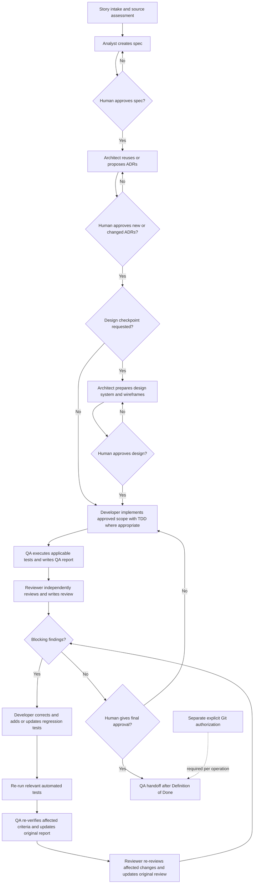

# Agentic Development Flow

See the execution log for completed stages and checkpoint status.

## Steps and planned outputs

| Step | What happens and why | AI used? | Agent / model / skill | Expected repository artifact | Human review, rejection path |
| --- | --- | --- | --- | --- | --- |
| 1. Ingest story | Read source and identify constraints | Yes | analyst; `gpt-6-luna` / `xhigh`; `story-to-spec` and `spec-driven-development` | `spec/US-XX.md` draft | Review omissions; send rejected specs back to analyst |
| 2. Approve spec | Make acceptance criteria verifiable | No | Human | `docs/approvals/` decision record | Do not proceed if rejected |
| 3. Choose architecture | Compare alternatives and consequences | Yes | architect; `gpt-6.2-sol` / `high`; `spec-driven-development`, `angular-developer`, plus relevant `modern-web-guidance` when needed | `docs/adr/ADR-XXX-*.md` | Reject weak/unsupported choices for revision |
| 4. Approve ADR | Resolve consequential trade-offs | No | Human | `docs/approvals/` decision record | Return to architect on rejection |
| 4a. Design the experience, when requested | Translate the approved specification and ADRs into reusable UI guidance and observable interactions | Yes | architect and applicable interface, accessibility, and web design skills | `docs/design/` proposal and wireframes | Return design feedback to architect |
| 4b. Approve design | Review layouts, components, states, and interactions before implementation | No | Human | `docs/approvals/` decision record | Wait for explicit design approval |
| 5. Implement story | Build a constrained increment | Yes | developer; `gpt-6.2-sol` / `medium`; `angular-developer`, `frontend-ui-engineering`, `test-driven-development`; conditional skills per `AGENTS.md` | `frontend/`, `backend/` and tests | Review scope and functional behavior |
| 6. Test | Verify story scope and applicable criteria | Yes | qa; `gpt-6-luna` / `xhigh`; `test-driven-development`; conditional skills per `AGENTS.md` | Tests and `reports/qa/US-XX-qa-report.md` | Record dependent flow-level checks as deferred until prerequisites exist |
| 7. Review | Independent defect/security analysis | Yes | reviewer; `gpt-6.2-sol` / `medium`; `code-review-and-quality`; conditional skills per `AGENTS.md` | `reviews/US-XX-review.md` | Findings return to developer; QA and Reviewer re-verify |
| 8. Final approval and QA handoff | Confirm Definition of Done, traceability, and evidence | No | Human | Approval record + traceability references | Do not advance without explicit approval |

## Actual execution log

| Date / event | User story | Actual agent / model / effort | Actual inputs and prompts | Outputs and commands | Human decision and review evidence | Original session reference |
| --- | --- | --- | --- | --- | --- | --- |
| 2026-11-21, 14:27 COT · Intake | US-01 | Orchestrator, `gpt-6.2-sol` / `medium` | User requested US-01 through the first human approval checkpoint. Read `AGENTS.md` and `requirements/technical-assessment.pdf`. Skills used were `using-agent-skills` and `pdf`. | Extracted the assessment with bundled Python and `pypdf.PdfReader`. Rendered and visually checked pages 5–6 with `pypdfium2.PdfDocument`. | Confirmed story title, business rules, and four source acceptance scenarios. | Codex Desktop original `01a1ff94-4d15-7ad2-9b6b-fdabfc1dc367`, started 2026-11-21 14:27:51 COT. |
| 2026-11-21, 14:28 COT · Specification draft | US-01 | `analyst` at `/root/us01_analyst`, `gpt-6-luna` / `xhigh` | Asked the analyst to draft only `spec/US-01.md` from the original source and project instructions, with country cases, stable acceptance and test IDs, validation boundaries, state handling, and open questions. The analyst used the repository's `story-to-spec` and `spec-driven-development` skills. | The analyst extracted the PDF using bundled Python and drafted the specification. The orchestrator compared the draft with the assessment and requested corrections to source references and coverage. | The draft was pending human approval. | Codex Desktop original `01a1ff94-bc29-7403-8d97-7240a466b406`, started 2026-11-21 14:28:20 COT. |
| 2026-11-21, 14:30 COT · Specification revision | US-01 | Same analyst session, `gpt-6-luna` / `xhigh` | Asked the analyst to correct the typed-forms page reference, distinguish project state requirements from the assessment, and add an explicit source-to-test crosswalk and verification for accessibility, responsive layouts, field configuration, and removing or reordering published fields. | The analyst revised `spec/US-01.md`. The orchestrator ran a Python crosswalk check and verified that all 14 source items, 10 acceptance criteria, and 10 proposed tests are represented. | Source review and document checks only. Application tests are proposed for later stages. | Same analyst original, revision turn started 2026-11-21 14:30:21 COT. |
| 2026-11-21 · Specification approval checkpoint | US-01 | Orchestrator, `gpt-6.2-sol` / `medium` | Presented `spec/US-01.md` Draft 1 for explicit human approval or rejection. | Specification and execution log available for review. | Awaited the project owner's decision on Draft 1. | Same orchestrator original. |
| 2026-11-21, 15:03 COT · Specification feedback | US-01 | Project owner, then orchestrator `gpt-6.2-sol` / `medium` | The owner answered Q-US01-01, Q-US01-02, Q-US01-04 through Q-US01-07, and Q-US01-09. | The orchestrator asked the analyst to apply the answers to the draft and related acceptance criteria and tests, and to retain unanswered details. | The owner supplied decisions on individual questions. The specification approval checkpoint remains open. | Same orchestrator original, feedback turn started at 15:03:40 COT. |
| 2026-11-21 · Revised specification | US-01 | Same analyst session, `gpt-6-luna` / `xhigh`, then orchestrator | Incorporated the owner's answers on age, locale year, URL country context, stable field identifiers, cache freshness, progressive validation, and Spanish copy. | The analyst updated `spec/US-01.md` to Draft 2. The orchestrator cross-checked the seven answers, five remaining question entries, 14 source items, 12 acceptance criteria, and 12 proposed tests. | Draft 2 is pending explicit human approval. | Same analyst original, feedback revision started at 15:03:50 COT. |
| 2026-11-21, 15:14 COT · Outstanding specification decisions | US-01 | Project owner, then orchestrator `gpt-6.2-sol` / `medium` | The owner supplied written decisions for Q-US01-03, Q-US01-04, Q-US01-05, Q-US01-07, and Q-US01-08. | The orchestrator delegated incorporation of the validation contract, country URL rules, reconciliation, progressive validation, and configuration failures to the analyst. | The owner requested a revised draft and a stop at the specification approval checkpoint. | Same orchestrator original, feedback turn started at 15:14:41 COT. |
| 2026-11-21 · Specification Draft 3 | US-01 | Same analyst session, `gpt-6-luna` / `xhigh`, then orchestrator | The analyst incorporated the owner's refinements as human clarifications, traced them to acceptance criteria and proposed tests, and separated resolved requirements from deferred architecture details. | Updated `spec/US-01.md` to Draft 3. The orchestrator used a Python document check to verify nine resolved question IDs, 11 validation operators, 14 source items, 16 acceptance criteria, and 16 proposed tests. `git diff --check` passed. | Draft 3 is pending explicit human approval. | Same analyst original, feedback revision started at 15:14:54 COT. |
| 2026-11-21, 15:25 COT · Specification approved | US-01 | Project owner, then orchestrator | The owner wrote “approve Draft 3”. | Recorded the decision in `docs/approvals/US-01-spec-approval.md` and updated the approval metadata in `spec/US-01.md`. | Draft 3 approved. Workflow stopped at the specification checkpoint as requested. | Same orchestrator original. |
| 2026-11-21, 15:33 COT · Architecture intake | US-01 | Orchestrator, `gpt-6.2-sol` / `medium`, then `architect` at `/root/us01_architect`, `gpt-6.2-sol` / `high` | The owner requested a technology-stack proposal, a country strategy, and consideration of shared needs for US-02 and US-03. The approved US-01 spec, approval record, and original assessment were supplied to the architect. | The orchestrator independently checked official Angular, Strapi, Tailwind CSS, and Tabler documentation and the assessment's cross-story requirements. | The owner's stack preferences and new architectural decisions are proposals. | Codex Desktop architect original `01a1ffd0-8d90-70c2-91c2-cb922bbb8cdd`, started 2026-11-21 at 15:33:40 COT. |
| 2026-11-21 · Architecture proposals and approval checkpoint | US-01 | Same architect session, `gpt-6.2-sol` / `high`, then orchestrator | The architect used the repository's `spec-driven-development` and `angular-developer` skills and the bundled `modern-web-guidance` guides on validation after interaction, required-field feedback, and accessible error announcements. The architect extracted assessment pages 1–3 and 6–9 and consulted official stack documentation. | Produced `docs/architecture/US-01-technology-stack.md` and ADR-001, ADR-002, and ADR-003 under `docs/adr/`. Python document checks verified four pending proposals, valid relative links, stack coverage, and all 11 validation operators. `git diff --check` passed. Package installation, builds, and runtime verification remain future work. | Presented the architecture proposals for explicit human approval. No architecture approval or implementation was undertaken. | Same architect original, turn `01a1ffd0-8e18-7730-bc13-629ba331494e`, and orchestrator original. |
| 2026-11-22 · Architecture approved | US-01 | Project owner, then orchestrator | The owner wrote “approve the stack proposal and ADR-001 through ADR-003”. | Recorded the decision in `docs/approvals/US-01-architecture-approval.md` and updated the status in all four approved artifacts. | Architecture checkpoint complete. Workflow stopped before implementation as requested. | Same orchestrator original. |
| 2026-11-22, 08:58 COT · Design intake | US-01 | Orchestrator, `gpt-6.2-sol` / `medium`, then architect, `gpt-6.2-sol` / `high` | The owner requested a reusable design system and desktop and mobile wizard wireframes. The orchestrator delegated the design to the architect using the approved US-01 specification, ADR-001 through ADR-003, the approved stack, and the assessment's later-story scenarios. | Added the requested design checkpoint to this workflow and checked W3C WCAG 2.2 and form notification guidance. | Design review is a dedicated human checkpoint. | Same architect original, design turn `01a2038d-164b-7d33-87ea-ef249e83f879`, started at 08:58:29 COT. |
| 2026-11-22 · Design proposal and approval checkpoint | US-01 | Same architect session, `gpt-6.2-sol` / `high`, then orchestrator | The architect used `interface-design`, `frontend-ui-engineering`, `accessibility`, and the bundled `modern-web-guidance` guides on interaction validation, required fields, and accessible error announcements. The design follows the approved US-01 artifacts and uses assessment pages 6–9 for story context. | Produced `docs/design/US-01-design-system.md`, `docs/design/US-01-wireframes.md`, and 26 SVG wireframes. The architect checked all 16 acceptance criteria references, local links, accessible names, and token contrast. The orchestrator independently rendered all 26 SVGs with bundled Sharp and visually reviewed desktop and mobile contact sheets. | Presented for explicit human design approval. US-02 and US-03 are design concepts, with production behavior reserved for their own checkpoints. | Same architect design turn and orchestrator turn `01a2038c-c310-7671-960a-a2b85f8b8990`. |
| 2026-11-22, 09:25 COT · Design feedback | US-01 | Project owner, then orchestrator and architect | The owner requested a centered desktop step, primary color `#2E6DF6`, and removal of the country name and change text from the header. | The orchestrator delegated the revision and checked the primary fill against white text. | The design remains pending explicit approval. | Same architect original, revision turn `01a203a5-b6db-7c00-b7c1-0877f2516bde`, started at 09:25:21 COT. |
| 2026-11-22 · Revised design proposal | US-01 | Same architect session, `gpt-6.2-sol` / `high`, then orchestrator | Applied the owner's three design changes. Kept country switching available below progress in the main content and used a darker blue for inline links and focus. | Updated both design documents and all 26 SVGs. Rendered the wireframes with bundled Sharp and used a Python XML check to verify 26 product-only headers, 22 in-content country controls, and 11 centered desktop step compositions. White on the primary blue measured 4.53:1. | Revised design presented for explicit human approval. | Same architect revision turn and orchestrator turn `01a203a5-71f1-7830-992a-69fa822cc302`. |
| 2026-11-22, 09:33 COT · Country control removal | US-01 | Project owner, then architect, `gpt-6.2-sol` / `high`, and orchestrator | The owner supplied a screenshot of the country badge and change-country link and requested removal wherever they appeared in wizard steps. | Updated both design documents and removed the control from 22 desktop and mobile SVGs. Rendered all 26 wireframes with bundled Sharp. A Python XML and hash check verified removal and preservation of the four country picker and unsupported-country recovery frames. | Revised proposal remains pending explicit human design approval. | Same architect original, revision turn `01a203ad-0e5b-7631-b741-68ba7e746c72`, started at 09:33:22 COT. |
| 2026-11-22 · Design approved | US-01 | Project owner, then orchestrator | The owner wrote “approve the design”. | Recorded `docs/approvals/US-01-design-approval.md` and updated the status in both design documents. Verified the approved wireframe set by hash. | Design checkpoint complete. Workflow stopped before implementation as requested. | Same orchestrator original. |

### US-01 session evidence

The native Codex Desktop records retain the original prompts, agent results, and tool calls. The orchestrator, analyst, and architect rollout files contain account identifiers in session metadata. The originals are retained in Codex Desktop, and a repository copy is pending a safe, unedited export. See `logs/README.md`.

## Skill selection and controls

The project-specific `story-to-spec` skill defines the insurance assessment source and specification format. Other installed skills are third-party workflow or technical guidance. Select skills by stage and task as listed in `AGENTS.md`. Conditional skills are loaded only when the work warrants them. Project instructions and assessment requirements take precedence over conflicting skill guidance. Skills do not bypass security restrictions or human approval checkpoints. Record skills actually used in execution evidence and keep this proposed flow distinct from completed work.

## Git conventions and authorization

Use English Conventional Commit messages in `<type>(<optional-scope>): <description>` format, with focused atomic changes. Suggest a commit message when work is ready. Staging, committing, pushing, merging, branch creation or deletion, history rewriting, and destructive Git actions each require explicit human authorization for that operation. Approval of a specification or code does not grant Git authorization. Read-only Git inspection is allowed. Never place credentials, secrets, personal data, or sensitive information in commits or logs.

## Model allocation and usage

Keep the configured model and effort assignments from `docs/agent-model-policy.md`. Choose the least number of agents and skills needed for a task. Avoid loading all skills or invoking agents without a concrete independent responsibility. The project targets a ChatGPT Plus subscription, so use focused prompts, narrow source reads, sequential checkpoints, and only the context needed for each stage. Do not claim a subscription allowance, cost, or usage outcome that has not been verified.

## Required retrospective (complete with authentic experience)

## Traceability and verification levels

Maintain `User Story → spec/US-XX.md → applicable approved ADRs → approved design (when requested) → implementation → stable test case IDs → reports/qa/US-XX-qa-report.md → reviews/US-XX-review.md → finding resolution evidence → human approval`. Reference repository paths and actual evidence. Reuse approved ADRs when they cover the story. Story reports cover the current story only. Complete quote-flow and cross-country verification are project-level checks before final delivery, not prerequisites for each story when later stories are pending.

### How would this flow change for a five-developer team?
To be completed after applying the process. Consider ownership boundaries, review queues, parallel safe tasks, and shared quality gates.

### What did not work as expected, and what changed?
To be completed using actual incidents only. Never invent a process failure.

### Where did we deliberately avoid using AI, and why?
To be completed using actual human checkpoints and decisions.
