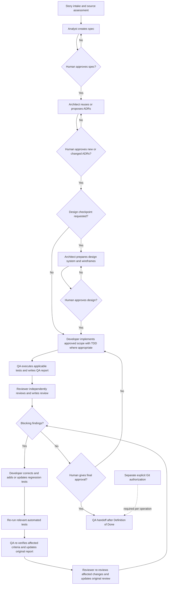

# Agentic Development Flow

See the execution log for completed stages and checkpoint status.

## Steps and planned outputs

| Step | What happens and why | AI used? | Agent / model / skill | Expected repository artifact | Human review, rejection path |
| --- | --- | --- | --- | --- | --- |
| 1. Ingest story | Read source and identify constraints | Yes | analyst; `gpt-6-luna` / `xhigh`; `story-to-spec` and `spec-driven-development` | `spec/US-XX.md` draft | Review omissions; send rejected specs back to analyst |
| 2. Approve spec | Make acceptance criteria verifiable | No | Human | `docs/approvals/` decision record | Do not proceed if rejected |
| 3. Choose architecture | Compare alternatives and consequences | Yes | architect; `gpt-6.2-sol` / `high`; `spec-driven-development`, `angular-developer`, plus relevant `modern-web-guidance` when needed | `docs/adr/ADR-XXX-*.md` | Reject weak/unsupported choices for revision |
| 4. Approve ADR | Resolve consequential trade-offs | No | Human | `docs/approvals/` decision record | Return to architect on rejection |
| 4a. Design the experience, when requested | Translate the approved specification and ADRs into reusable UI guidance and observable interactions | Yes | architect and applicable interface, accessibility, and web design skills | `docs/design/` proposal and wireframes | Return design feedback to architect |
| 4b. Approve design | Review layouts, components, states, and interactions before implementation | No | Human | `docs/approvals/` decision record | Wait for explicit design approval |
| 5. Implement story | Build a constrained increment | Yes | developer; `gpt-6.2-sol` / `medium`; `angular-developer`, `frontend-ui-engineering`, `test-driven-development`; conditional skills per `AGENTS.md` | `frontend/`, `backend/` and tests | Review scope and functional behavior |
| 6. Test | Verify story scope and applicable criteria | Yes | qa; `gpt-6-luna` / `xhigh`; `test-driven-development`; conditional skills per `AGENTS.md` | Tests and `reports/qa/US-XX-qa-report.md` | Record dependent flow-level checks as deferred until prerequisites exist |
| 7. Review | Independent defect/security analysis | Yes | reviewer; `gpt-6.2-sol` / `medium`; `code-review-and-quality`; conditional skills per `AGENTS.md` | `reviews/US-XX-review.md` | Findings return to developer; QA and Reviewer re-verify |
| 8. Final approval and QA handoff | Confirm Definition of Done, traceability, and evidence | No | Human | Approval record + traceability references | Do not advance without explicit approval |

## Actual execution log

| Date / event | User story | Actual agent / model / effort | Actual inputs and prompts | Outputs and commands | Human decision and review evidence | Original session reference |
| --- | --- | --- | --- | --- | --- | --- |
| 2026-11-21, 14:27 COT · Intake | US-01 | Orchestrator, `gpt-6.2-sol` / `medium` | User requested US-01 through the first human approval checkpoint. Read `AGENTS.md` and `requirements/technical-assessment.pdf`. Skills used were `using-agent-skills` and `pdf`. | Extracted the assessment with bundled Python and `pypdf.PdfReader`. Rendered and visually checked pages 5–6 with `pypdfium2.PdfDocument`. | Confirmed story title, business rules, and four source acceptance scenarios. | Codex Desktop original `01a1ff94-4d15-7ad2-9b6b-fdabfc1dc367`, started 2026-11-21 14:27:51 COT. |
| 2026-11-21, 14:28 COT · Specification draft | US-01 | `analyst` at `/root/us01_analyst`, `gpt-6-luna` / `xhigh` | Asked the analyst to draft only `spec/US-01.md` from the original source and project instructions, with country cases, stable acceptance and test IDs, validation boundaries, state handling, and open questions. The analyst used the repository's `story-to-spec` and `spec-driven-development` skills. | The analyst extracted the PDF using bundled Python and drafted the specification. The orchestrator compared the draft with the assessment and requested corrections to source references and coverage. | The draft was pending human approval. | Codex Desktop original `01a1ff94-bc29-7403-8d97-7240a466b406`, started 2026-11-21 14:28:20 COT. |
| 2026-11-21, 14:30 COT · Specification revision | US-01 | Same analyst session, `gpt-6-luna` / `xhigh` | Asked the analyst to correct the typed-forms page reference, distinguish project state requirements from the assessment, and add an explicit source-to-test crosswalk and verification for accessibility, responsive layouts, field configuration, and removing or reordering published fields. | The analyst revised `spec/US-01.md`. The orchestrator ran a Python crosswalk check and verified that all 14 source items, 10 acceptance criteria, and 10 proposed tests are represented. | Source review and document checks only. Application tests are proposed for later stages. | Same analyst original, revision turn started 2026-11-21 14:30:21 COT. |
| 2026-11-21 · Specification approval checkpoint | US-01 | Orchestrator, `gpt-6.2-sol` / `medium` | Presented `spec/US-01.md` Draft 1 for explicit human approval or rejection. | Specification and execution log available for review. | Awaited the project owner's decision on Draft 1. | Same orchestrator original. |
| 2026-11-21, 15:03 COT · Specification feedback | US-01 | Project owner, then orchestrator `gpt-6.2-sol` / `medium` | The owner answered Q-US01-01, Q-US01-02, Q-US01-04 through Q-US01-07, and Q-US01-09. | The orchestrator asked the analyst to apply the answers to the draft and related acceptance criteria and tests, and to retain unanswered details. | The owner supplied decisions on individual questions. The specification approval checkpoint remains open. | Same orchestrator original, feedback turn started at 15:03:40 COT. |
| 2026-11-21 · Revised specification | US-01 | Same analyst session, `gpt-6-luna` / `xhigh`, then orchestrator | Incorporated the owner's answers on age, locale year, URL country context, stable field identifiers, cache freshness, progressive validation, and Spanish copy. | The analyst updated `spec/US-01.md` to Draft 2. The orchestrator cross-checked the seven answers, five remaining question entries, 14 source items, 12 acceptance criteria, and 12 proposed tests. | Draft 2 is pending explicit human approval. | Same analyst original, feedback revision started at 15:03:50 COT. |
| 2026-11-21, 15:14 COT · Outstanding specification decisions | US-01 | Project owner, then orchestrator `gpt-6.2-sol` / `medium` | The owner supplied written decisions for Q-US01-03, Q-US01-04, Q-US01-05, Q-US01-07, and Q-US01-08. | The orchestrator delegated incorporation of the validation contract, country URL rules, reconciliation, progressive validation, and configuration failures to the analyst. | The owner requested a revised draft and a stop at the specification approval checkpoint. | Same orchestrator original, feedback turn started at 15:14:41 COT. |
| 2026-11-21 · Specification Draft 3 | US-01 | Same analyst session, `gpt-6-luna` / `xhigh`, then orchestrator | The analyst incorporated the owner's refinements as human clarifications, traced them to acceptance criteria and proposed tests, and separated resolved requirements from deferred architecture details. | Updated `spec/US-01.md` to Draft 3. The orchestrator used a Python document check to verify nine resolved question IDs, 11 validation operators, 14 source items, 16 acceptance criteria, and 16 proposed tests. `git diff --check` passed. | Draft 3 is pending explicit human approval. | Same analyst original, feedback revision started at 15:14:54 COT. |
| 2026-11-21, 15:25 COT · Specification approved | US-01 | Project owner, then orchestrator | The owner wrote “approve Draft 3”. | Recorded the decision in `docs/approvals/US-01-spec-approval.md` and updated the approval metadata in `spec/US-01.md`. | Draft 3 approved. Workflow stopped at the specification checkpoint as requested. | Same orchestrator original. |
| 2026-11-21, 15:33 COT · Architecture intake | US-01 | Orchestrator, `gpt-6.2-sol` / `medium`, then `architect` at `/root/us01_architect`, `gpt-6.2-sol` / `high` | The owner requested a technology-stack proposal, a country strategy, and consideration of shared needs for US-02 and US-03. The approved US-01 spec, approval record, and original assessment were supplied to the architect. | The orchestrator independently checked official Angular, Strapi, Tailwind CSS, and Tabler documentation and the assessment's cross-story requirements. | The owner's stack preferences and new architectural decisions are proposals. | Codex Desktop architect original `01a1ffd0-8d90-70c2-91c2-cb922bbb8cdd`, started 2026-11-21 at 15:33:40 COT. |
| 2026-11-21 · Architecture proposals and approval checkpoint | US-01 | Same architect session, `gpt-6.2-sol` / `high`, then orchestrator | The architect used the repository's `spec-driven-development` and `angular-developer` skills and the bundled `modern-web-guidance` guides on validation after interaction, required-field feedback, and accessible error announcements. The architect extracted assessment pages 1–3 and 6–9 and consulted official stack documentation. | Produced `docs/architecture/US-01-technology-stack.md` and ADR-001, ADR-002, and ADR-003 under `docs/adr/`. Python document checks verified four pending proposals, valid relative links, stack coverage, and all 11 validation operators. `git diff --check` passed. Package installation, builds, and runtime verification remain future work. | Presented the architecture proposals for explicit human approval. No architecture approval or implementation was undertaken. | Same architect original, turn `01a1ffd0-8e18-7730-bc13-629ba331494e`, and orchestrator original. |
| 2026-11-22 · Architecture approved | US-01 | Project owner, then orchestrator | The owner wrote “approve the stack proposal and ADR-001 through ADR-003”. | Recorded the decision in `docs/approvals/US-01-architecture-approval.md` and updated the status in all four approved artifacts. | Architecture checkpoint complete. Workflow stopped before implementation as requested. | Same orchestrator original. |
| 2026-11-22, 08:58 COT · Design intake | US-01 | Orchestrator, `gpt-6.2-sol` / `medium`, then architect, `gpt-6.2-sol` / `high` | The owner requested a reusable design system and desktop and mobile wizard wireframes. The orchestrator delegated the design to the architect using the approved US-01 specification, ADR-001 through ADR-003, the approved stack, and the assessment's later-story scenarios. | Added the requested design checkpoint to this workflow and checked W3C WCAG 2.2 and form notification guidance. | Design review is a dedicated human checkpoint. | Same architect original, design turn `01a2038d-164b-7d33-87ea-ef249e83f879`, started at 08:58:29 COT. |
| 2026-11-22 · Design proposal and approval checkpoint | US-01 | Same architect session, `gpt-6.2-sol` / `high`, then orchestrator | The architect used `interface-design`, `frontend-ui-engineering`, `accessibility`, and the bundled `modern-web-guidance` guides on interaction validation, required fields, and accessible error announcements. The design follows the approved US-01 artifacts and uses assessment pages 6–9 for story context. | Produced `docs/design/US-01-design-system.md`, `docs/design/US-01-wireframes.md`, and 26 SVG wireframes. The architect checked all 16 acceptance criteria references, local links, accessible names, and token contrast. The orchestrator independently rendered all 26 SVGs with bundled Sharp and visually reviewed desktop and mobile contact sheets. | Presented for explicit human design approval. US-02 and US-03 are design concepts, with production behavior reserved for their own checkpoints. | Same architect design turn and orchestrator turn `01a2038c-c310-7671-960a-a2b85f8b8990`. |
| 2026-11-22, 09:25 COT · Design feedback | US-01 | Project owner, then orchestrator and architect | The owner requested a centered desktop step, primary color `#2E6DF6`, and removal of the country name and change text from the header. | The orchestrator delegated the revision and checked the primary fill against white text. | The design remains pending explicit approval. | Same architect original, revision turn `01a203a5-b6db-7c00-b7c1-0877f2516bde`, started at 09:25:21 COT. |
| 2026-11-22 · Revised design proposal | US-01 | Same architect session, `gpt-6.2-sol` / `high`, then orchestrator | Applied the owner's three design changes. Kept country switching available below progress in the main content and used a darker blue for inline links and focus. | Updated both design documents and all 26 SVGs. Rendered the wireframes with bundled Sharp and used a Python XML check to verify 26 product-only headers, 22 in-content country controls, and 11 centered desktop step compositions. White on the primary blue measured 4.53:1. | Revised design presented for explicit human approval. | Same architect revision turn and orchestrator turn `01a203a5-71f1-7830-992a-69fa822cc302`. |
| 2026-11-22, 09:33 COT · Country control removal | US-01 | Project owner, then architect, `gpt-6.2-sol` / `high`, and orchestrator | The owner supplied a screenshot of the country badge and change-country link and requested removal wherever they appeared in wizard steps. | Updated both design documents and removed the control from 22 desktop and mobile SVGs. Rendered all 26 wireframes with bundled Sharp. A Python XML and hash check verified removal and preservation of the four country picker and unsupported-country recovery frames. | Revised proposal remains pending explicit human design approval. | Same architect original, revision turn `01a203ad-0e5b-7631-b741-68ba7e746c72`, started at 09:33:22 COT. |
| 2026-11-22 · Design approved | US-01 | Project owner, then orchestrator | The owner wrote “approve the design”. | Recorded `docs/approvals/US-01-design-approval.md` and updated the status in both design documents. Verified the approved wireframe set by hash. | Design checkpoint complete. Workflow stopped before implementation as requested. | Same orchestrator original. |
| 2026-11-22, 09:39 COT · Implementation intake | US-01 | Orchestrator and `developer` at `/root/us01_developer`, both `gpt-6.2-sol` / `medium` | The owner requested implementation through QA, independent review, and final human approval. The orchestrator delegated US-01 against the approved spec, architecture, stack, and design, with TDD and release evidence. | Read-only Git inspection verified a clean starting tree. Node 24 is installed and bare pnpm is version 12, so the implementation must use the approved pnpm 11 pin. OrbStack was started under a scoped approval after its local socket was unavailable. | Implementation authorized. Git mutations remain unauthorized. New dependencies outside the approved stack and changes to approved decisions remain separate checkpoints. | Codex Desktop developer original `01a203b2-e546-7670-ab7f-9562b27dcfa4`, started at 09:39:45 COT. |
| 2026-11-22 · Implementation and developer verification | US-01 | Same developer session, `gpt-6.2-sol` / `medium`, and orchestrator | Implemented the Angular wizard, shared typed form contract, Strapi content and seeds, and Compose startup. Skills used were `angular-new-app`, `angular-developer`, `frontend-ui-engineering`, `test-driven-development`, `modern-web-guidance`, `security-and-hardening`, and browser-testing guidance with Playwright. | TDD started with the missing shared contract and frontend route tests failing. The developer reported `pnpm test` passing five contract and two Angular tests, `pnpm test:content` passing one isolated live content integration, `pnpm lint`, `pnpm format:check`, and `pnpm build` passing, and three Chromium Playwright tests passing against the running stack. | Initial container checks uncovered a missing Angular signal invocation and required Strapi favicon middleware. The developer corrected both. The orchestrator verified a successful Compose build and startup from a fresh isolated volume, and HTTP 200 country deep links and form reads for CO and CL. Independent QA follows. | Developer turn `01a203b2-e595-71d2-b6cd-287bea3d226d` and orchestrator turn `01a203b2-a09e-7011-a674-2dbd729c38a2`. |
| 2026-11-22, 10:00 COT · Independent QA interrupted | US-01 | `qa` at `/root/us01_qa`, `gpt-6-luna` / `xhigh` | Asked QA to independently verify the approved acceptance criteria against the rebuilt Compose stack and record results, omissions, and defects. | QA reported five shared and two Angular tests passing, one live Strapi publication test passing on a disposable database, and three browser tests passing with installed Google Chrome. Additional keyboard coverage in `e2e/us01-qa.spec.ts` was still in progress. | QA hit its model usage limit before producing its required report. No product blocker had been confirmed. The orchestrator requested approval before substituting a model. Independent review remains pending. | Codex Desktop QA original `01a203c5-dd72-73c0-9ed7-7945930842d2`, started at 10:00:28 COT. |
| 2026-11-22 · Strapi first-run verification | US-01 | Orchestrator, `gpt-6.2-sol` / `medium` | The owner asked whether the first-run screen requires local or Cloud registration. The orchestrator used browser-testing guidance and isolated Playwright Chrome, and checked official Strapi documentation. | Read-only GET checks and browser navigation found `hasAdmin: false`, local `/admin/auth/register-admin`, public app admin routes HTTP 404, and both published form endpoints HTTP 200 with 8 CO and 7 CL fields. Clarified the optional editorial account in `README.md`. | Public evaluation needs no administrator account. Account creation and authenticated editorial verification were outside this request. | Orchestrator original. |
| 2026-11-22, 10:18 COT · Frontend structure assessment | US-01 | Architect, `gpt-6.2-sol` / `high`, then orchestrator | The owner asked to assess feature-based organization, test colocation and naming, root Playwright coverage, and reuse of the shared package. The architect used the Angular developer skill and official style guide. | Wrote `docs/architecture/US-01-frontend-structure-assessment.md` with the current-to-proposed mapping, alternatives, migration risks and verification steps. Checked local links and repository whitespace. | Structural refactor awaits separate explicit approval and is outside current verification. | Same architect original, assessment turn `01a203d6-97f2-7d90-8104-73a2f09d2984`. |
| 2026-11-22, 10:36 COT · Independent QA resumed | US-01 | Same QA session, `gpt-6-luna` / `xhigh` | The owner requested a retry using the configured QA model and the existing test evidence. | The original QA subagent resumed its unfinished verification and report. The native session record confirmed the configured model and effort. | No replacement model was required. | Same QA original, resumed turn `01a203e6-62c3-7f72-9fd4-162b1a6a1006`. |
| 2026-11-22 · Independent QA report | US-01 | Same QA session, `gpt-6-luna` / `xhigh` | QA used `test-driven-development`, Angular testing guidance, `browser-testing-with-devtools` with Playwright and `debugging-and-error-recovery`. | Added focused shared and browser verification. The report records nine shared and two Angular tests, one live Strapi content test, six Chrome Playwright cases, lint, formatting, and a successful cache-disabled Angular build. | QA found no confirmed product defect and recommended independent review. A full keyboard-only completion and a combined real publication and browser reload still lacked end-to-end evidence. | Same QA original and resumed turn. |
| 2026-11-22 · Independent code review and correction checkpoint | US-01 | `reviewer` at `/root/us01_reviewer`, `gpt-6.2-sol` / `medium` | Reviewed the approved artifacts, implementation and QA evidence using `code-review-and-quality`. | Wrote `reviews/US-01-review.md` with five Medium blocking findings, US01-R01 through US01-R05. Browser and Node probes reproduced the first four. The fifth was established by inspection of app bootstrap and the pinned Strapi permissions plugin. | Changes requested. The orchestrator requested explicit permission to adjust the Strapi Public role for US01-R05. No Strapi settings or administrator accounts changed. | Codex Desktop reviewer original `01a203f5-ba5a-7653-a44c-532946bacda7`, review turn `01a203f5-bacb-7380-b491-ce0f40bc01a8`. |
| 2026-11-22 · Targeted keyboard QA follow-up | US-01 | Same QA session, `gpt-6-luna` / `xhigh` | Asked QA to close the keyboard and publication evidence gaps without repeating completed checks unless affected. | Verified a complete valid Colombia form and return path with Chrome key events only. All six browser cases passed after updating the keyboard test. Updated the original QA report. | The full keyboard smoke passed with seeded content. The review findings still require targeted follow-up checks. The combined real Strapi publication and browser reload check was parked at the correction checkpoint. | Same QA original, follow-up turn `01a203f5-fec9-7202-b429-dbaa2d6381c4`. |

### US-01 correction and refactor

After initial commit `cb705ed`, the owner authorized US01-R01 through US01-R05 and the feature-folder proposal. See [the authorization record](docs/approvals/US-01-correction-and-refactor-approval.md). The original developer resumed with the repository's current `gpt-6.2-sol` / `low` assignment in turn `01a20409-49e1-78f2-91e9-9da61d2bdf81`. Targeted RED checks reproduced all five findings. The developer verified the corrections before moving the frontend source and its routed TestBed suite. Post-move results were 13 unit/component tests, one Strapi integration test, lint, formatting, builds, and eight browser tests discovered. The orchestrator rebuilt Compose before and after the moves and both services became healthy. QA owns the final browser run and live-publication evidence.

Independent QA resumed on `gpt-6-luna` / `xhigh` in turn `01a2040d-b2a0-7960-9f61-db3491d3dd9f`. [The QA report](reports/qa/US-01-qa-report.md) records 13 unit/component tests, eight Playwright cases, one Strapi content integration test, and a live disposable Strapi-to-browser check. Publishing, unpublishing, and retry behaved as expected with the same Angular bundle and retained browser draft.

The historical reviewer session resumed on its former `gpt-6.2-sol` / `medium` model and was interrupted. The current configured reviewer completed re-review on `gpt-6-luna` / `high` in original session `01a20418-f037-7262-9db7-01191d79882d`, turn `01a20418-f092-70f3-a48b-eaaed0e2a006`. [The review report](reviews/US-01-review.md) preserves all original findings and marks US01-R01 through US01-R05 resolved. US-01 is ready for the final human approval checkpoint.

### US-01 final approval and QA handoff

The project owner explicitly approved US-01. The [final approval record](docs/approvals/US-01-final-approval.md) links the approved artifacts, corrections, QA report, independent re-review, and deferred project verification. The developer and independent agents completed the story-level checks, all five findings are resolved, and the story is ready for QA handoff. The separate authorized fixes and refactor commits are `9b1c24d` and `068dbc1`.

### US-01 session evidence

The native Codex Desktop records retain the original prompts, agent results, and tool calls. The orchestrator and specialist rollout files contain account identifiers in session metadata. The originals are retained in Codex Desktop, and a repository copy is pending a safe, unedited export. See `logs/README.md`.

### 2026-11-22 · Approved Tailwind styling audit and correction

The project owner requested an audit against the approved US-01 architecture and authorized correcting the styling deviation, with build, lint, UI regression checks, and independent verification. The approved technology stack already selected Tailwind CSS 4 and its Angular-supported PostCSS path; no architecture or design decision changed.

- **Audit finding:** `frontend/package.json` pins `tailwindcss` and `@tailwindcss/postcss` to 4.3.5; `frontend/.postcssrc.json` registers the plugin; `frontend/src/styles.css` imports Tailwind and declares approved theme tokens; `frontend/angular.json` loads that stylesheet. Tailwind was installed, configured, and active, but templates mainly used semantic class names while global CSS applied utilities with `@apply`. This did not use template utilities as the primary styling surface required by the approved stack.
- **Correction:** Moved layout, spacing, responsive grid, typography, palette, controls, and component appearance into statically discoverable Angular template utilities. Retained CSS for theme/base rules, constrained content widths, focus and text wrapping behavior, dynamic invalid controls, selected placeholder color, the progress connector pseudo-element, and reduced motion. Added no dependency and preserved the pre-existing owner edit that removed the country-picker footer copy.
- **Initial regression discoveries:** The first utility migration removed semantic selector hooks used by the existing UI regression assertions; those hooks were restored without restoring CSS-driven component styling. Independent review then found a 40rem `sm` form breakpoint where the approved design requires 48rem. Changed the grid and action variants to Tailwind `md` (48rem), preserving the finding history in the original review report.
- **Orchestrator verification:** `pnpm lint` passed; `CI=1 pnpm build` passed (the plain initial host build had the known local Angular cache abort, exit 134); `CI=1 pnpm --filter quote-web build` passed against the final frontend state; `pnpm format:check` and `git diff --check` passed. Docker Compose rebuilt and reported healthy app and CMS services. The final `QUOTE_BROWSER_CHANNEL=chrome pnpm exec playwright test --workers=1` passed 8/8 Chromium cases. The first sandboxed browser attempts could not launch Chrome; execution outside the sandbox was approved for local UI verification.
- **Independent QA:** Delegated to `/root/styling_qa` under the configured QA role, `gpt-6-luna` / `xhigh`. QA independently reported lint, cache-disabled frontend build, format check, Compose startup, and 8/8 Playwright pass; a Chrome viewport probe at 640, 767, 768, and 800px confirmed one-column form and full-width Continue below 768px, two columns and 160px Continue at and above 768px, and the expected 58px progress track at all widths. QA appended the detailed evidence to [`reports/qa/US-01-qa-report.md`](reports/qa/US-01-qa-report.md).
- **Independent review:** Delegated to `/root/styling_review` under the configured reviewer role, `gpt-6.2-sol` / `medium`, using `code-review-and-quality`. The reviewer confirmed Tailwind setup and primary utility use, documented `US01-TW-R01` for the breakpoint mismatch, and preserved its original evidence in [`reviews/US-01-review.md`](reviews/US-01-review.md). After the orchestrator corrected the variants and QA verified boundary behavior, the reviewer re-reviewed the correction, marked US01-TW-R01 resolved, and approved this scoped styling change.
- **Session reference:** The collaboration tool did not expose native Codex Desktop session IDs for these two delegated invocations; none is invented. The original delegation prompts, outputs, and tool calls remain in the active Codex conversation.

### 2026-11-22 · US-02 intake and specification

- The project owner requested US-02 through the specification approval checkpoint. The orchestrator read `AGENTS.md` and `FLOW.md`, used the PDF skill to extract the relevant assessment text with bundled `pypdf.PdfReader`, and checked the existing Plans route and approved architecture and design references.
- The orchestrator delegated [US-02 Draft 1](spec/US-02.md) to `/root/us02_analyst`, using the configured Analyst role (`gpt-6-luna` / `xhigh`). The prompt scoped the work to the source requirements, testable acceptance criteria, US-01 reuse, and genuine gaps. The Analyst used `story-to-spec` and `spec-driven-development`, extracted assessment pages 2–3 and 7 with bundled `pypdf`, and reviewed the relevant US-01 artifacts, routes, state and shared contracts. The collaboration path identifies the original invocation. A native session ID and a safe, unedited repository export were unavailable in this run. The original activity remains in Codex.
- The orchestrator requested tighter criteria for the same-country handoff, explicit selection, stale prices, and Back navigation. The same Analyst revised Draft 1, checked whitespace with `git diff --check -- spec/US-02.md`, and returned the updated draft. The orchestrator checked the draft against the source and used Python to verify 11 source IDs, seven acceptance criteria, seven proposed test IDs, and pending approval status.
- Draft 1 is pending human approval. The proposed pricing baseline uses the configured base price as the final price. The plan content contract, public read projection and selection/price snapshot are scoped for architecture review after specification approval. Application verification was outside this checkpoint.

- The project owner wrote “approve Draft 1 as written”. The orchestrator recorded the [specification approval](docs/approvals/US-02-spec-approval.md), including the approved draft hash and the base-price proposal, and updated the specification's approval metadata. The workflow stopped at the completed specification checkpoint as requested.

### 2026-11-22 · US-02 architecture proposal

- The project owner requested architecture assessment through human approval. The orchestrator verified the approved US-02 specification and its pricing decision, then asked `/root/us02_architect`, using the configured Architect role (`gpt-6.2-sol` / `high`), to reuse ADR-001 through ADR-003 and document only gaps in the plan read contract and quote-state handoff.
- The Architect used `spec-driven-development` and `angular-developer`, including HTTP and route guard references. The Architect extracted relevant assessment pages with bundled `pypdf`, checked the existing routes, public permissions, proxy and quote state, and consulted official Strapi, Angular and ECMAScript internationalization documentation. The Architect produced one proposed [ADR-004](docs/adr/ADR-004-plan-catalog-and-selection.md), with the plan read contract, money representation and selection revalidation. The collaboration path identifies the invocation. The original activity remains in Codex. A native session ID and a safe repository export were unavailable in this run.
- The Architect checked relative links, pricing, status, whitespace and ADR count. The orchestrator used Python to verify local links, pending approval status, alignment with the approved base-price decision, and controls for the public read and handoff. Runtime verification is deferred to implementation. The proposal is pending explicit human approval at the architecture checkpoint.

- The project owner wrote “approve ADR-004”. The orchestrator recorded the [architecture approval](docs/approvals/US-02-architecture-approval.md) and updated ADR-004's approval metadata. The workflow stopped at the completed architecture checkpoint as requested.

## Skill selection and controls

The project-specific `story-to-spec` skill defines the insurance assessment source and specification format. Other installed skills are third-party workflow or technical guidance. Select skills by stage and task as listed in `AGENTS.md`. Conditional skills are loaded only when the work warrants them. Project instructions and assessment requirements take precedence over conflicting skill guidance. Skills do not bypass security restrictions or human approval checkpoints. Record skills actually used in execution evidence and keep this proposed flow distinct from completed work.

## Git conventions and authorization

Use English Conventional Commit messages in `<type>(<optional-scope>): <description>` format, with focused atomic changes. Suggest a commit message when work is ready. Staging, committing, pushing, merging, branch creation or deletion, history rewriting, and destructive Git actions each require explicit human authorization for that operation. Approval of a specification or code does not grant Git authorization. Read-only Git inspection is allowed. Never place credentials, secrets, personal data, or sensitive information in commits or logs.

## Model allocation and usage

Keep the configured model and effort assignments from `docs/agent-model-policy.md`. Choose the least number of agents and skills needed for a task. Avoid loading all skills or invoking agents without a concrete independent responsibility. The project targets a ChatGPT Plus subscription, so use focused prompts, narrow source reads, sequential checkpoints, and only the context needed for each stage. Do not claim a subscription allowance, cost, or usage outcome that has not been verified.

## Required retrospective (complete with authentic experience)

## Traceability and verification levels

Maintain `User Story → spec/US-XX.md → applicable approved ADRs → approved design (when requested) → implementation → stable test case IDs → reports/qa/US-XX-qa-report.md → reviews/US-XX-review.md → finding resolution evidence → human approval`. Reference repository paths and actual evidence. Reuse approved ADRs when they cover the story. Story reports cover the current story only. Complete quote-flow and cross-country verification are project-level checks before final delivery, not prerequisites for each story when later stories are pending.

### How would this flow change for a five-developer team?
To be completed after applying the process. Consider ownership boundaries, review queues, parallel safe tasks, and shared quality gates.

### What did not work as expected, and what changed?
To be completed using actual incidents only. Never invent a process failure.

### Where did we deliberately avoid using AI, and why?
To be completed using actual human checkpoints and decisions.
